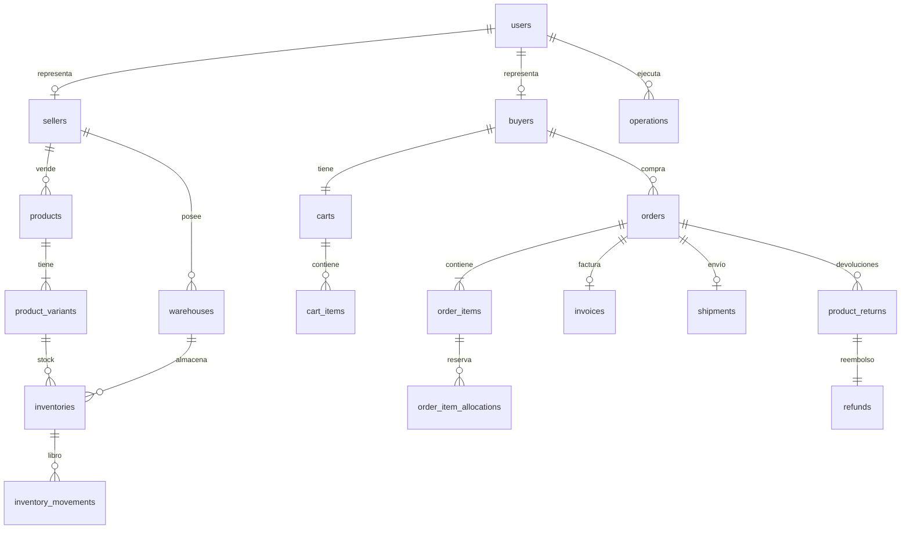

# Adaptadores de persistencia

## Introducción

Los adaptadores de persistencia implementan los **puertos de salida** de repositorio con Spring Data. El dominio no conoce JPA ni MongoDB: recibe y devuelve **modelos de dominio**, y la traducción se hace en *mappers* estáticos.

Se usan **dos almacenes**, cada uno con un propósito claro:

| Almacén | Tecnología | Contenido | Por qué |
|---|---|---|---|
| Relacional | PostgreSQL `NexusMarket` + Spring Data JPA | Usuarios, compradores, vendedores, bodegas, productos, inventario, movimientos, carritos, pedidos, facturas, envíos, devoluciones, reembolsos y `operations` | Integridad referencial, unicidad (SKU, correo, identificación, factura) y transacciones |
| Documental | MongoDB `audit_db`, colección `audit_logs` + Spring Data MongoDB | Registros de auditoría inmutables | Traza solo-agregar con detalles variables por operación, independiente del esquema relacional |

## Estructura de paquetes

```text
adapters/persistence
├── jpa
│   ├── entities       # entidades JPA (19 clases, incluye el embebible de dirección)
│   ├── mappers        # 16 mappers estáticos dominio ↔ entidad
│   ├── repositories   # 14 interfaces Spring Data JPA
│   └── adapters       # 14 adaptadores @Repository @Transactional que implementan los puertos
└── mongodb
    ├── documents      # AuditLogDocument
    ├── mappers        # AuditLogMongoMapper
    ├── repositories   # AuditLogMongoRepository
    └── adapters       # AuditLogMongoAdapter
```

## Convenciones del adaptador JPA

- Cada adaptador implementa **un** puerto de salida, se anota `@Repository` y `@Transactional`, y delega en su `*JpaRepository`.
- Los catálogos de negocio se guardan como **cadenas con el `code`** (`OrderStatus.PAID` → `"PAID"`); se reconstruyen con `fromCode`. No se usan `@Enumerated`.
- Toda relación `@ManyToOne` es `EAGER`; las colecciones hijas (`order_items`, `cart_items`, `product_variants`, …) usan `cascade = ALL` y `orphanRemoval = true`. Las listas se leen siempre dentro de la transacción.
- Los *mappers* siguen un patrón: `toEntity`, `toDomain` (completo), `ref` (entidad solo con id para relacionar sin cargar) y `toShallowDomain` (modelo solo con id/estado cuando basta). Los agregados ajenos se reconstruyen como referencias ligeras (solo id) para evitar ciclos.
- Las consultas son **métodos derivados** de Spring Data (`findByBuyer…`, `findByStatus…`); no hay SQL nativo. El filtro por estado `null` devuelve todos los registros.
- La numeración de facturas usa `InvoiceJpaRepository.nextSequenceValue()` (`select coalesce(max(i.id),0)+1`) y `InvoiceJpaAdapter.nextInvoiceNumber()` devuelve `INV-%08d`.
- `spring.jpa.hibernate.ddl-auto=update` crea y actualiza el esquema (apto para el proyecto académico; en producción se usaría una herramienta de migraciones).
- `spring.jpa.open-in-view=false`: no hay *lazy loading* fuera de la transacción.

## Mapa puerto → adaptador → repositorio Spring Data

| Puerto de salida | Adaptador | Repositorio |
|---|---|---|
| `UserRepositoryPort` | `UserJpaAdapter` | `UserJpaRepository` |
| `BuyerRepositoryPort` | `BuyerJpaAdapter` | `BuyerJpaRepository` |
| `SellerRepositoryPort` | `SellerJpaAdapter` | `SellerJpaRepository` |
| `WarehouseRepositoryPort` | `WarehouseJpaAdapter` | `WarehouseJpaRepository` |
| `ProductRepositoryPort` | `ProductJpaAdapter` | `ProductJpaRepository` |
| `InventoryRepositoryPort` | `InventoryJpaAdapter` | `InventoryJpaRepository` |
| `InventoryMovementRepositoryPort` | `InventoryMovementJpaAdapter` | `InventoryMovementJpaRepository` |
| `CartRepositoryPort` | `CartJpaAdapter` | `CartJpaRepository` |
| `OrderRepositoryPort` | `OrderJpaAdapter` | `OrderJpaRepository` |
| `InvoiceRepositoryPort` | `InvoiceJpaAdapter` | `InvoiceJpaRepository` |
| `ShipmentRepositoryPort` | `ShipmentJpaAdapter` | `ShipmentJpaRepository` |
| `ProductReturnRepositoryPort` | `ProductReturnJpaAdapter` | `ProductReturnJpaRepository` |
| `RefundRepositoryPort` | `RefundJpaAdapter` | `RefundJpaRepository` |
| `OperationRepositoryPort` | `OperationJpaAdapter` | `OperationJpaRepository` |
| `AuditLogRepositoryPort` | `AuditLogMongoAdapter` | `AuditLogMongoRepository` |

## Auditoría en MongoDB

- **Base y colección:** `audit_db.audit_logs` (propiedad `spring.mongodb.uri`).
- **Documento `AuditLogDocument`:** `id` (ObjectId como texto), `operationType`, `operationDate`, `performedById`, `performedByEmail`, `userRole`, `resourceType`, `resourceId`, `details` (mapa) y `severity`. Los campos `operationType`, `operationDate`, `performedById`, `resourceType` y `resourceId` están indexados.
- **Snapshot:** el usuario y el recurso se guardan como valores simples, no como referencias al esquema relacional, para que la auditoría sea una fotografía independiente.
- **Saneamiento de detalles:** `AuditLogMongoMapper` convierte `BigDecimal` a texto plano y cualquier otro tipo no primitivo a `toString()`, y nunca copia contraseñas.
- **Solo-agregar:** el puerto `AuditLogRepositoryPort` no expone actualización ni borrado.

### Consistencia entre PostgreSQL y MongoDB

`Operation` (PostgreSQL) y `AuditLog` (MongoDB) **no están en la misma transacción**: son almacenes distintos. El caso de uso confirma primero la transacción relacional; si MongoDB no está disponible en ese momento, el cambio de negocio puede quedar sin su registro de auditoría. Es una limitación conocida; las alternativas (*outbox*, transacciones distribuidas) quedan fuera del alcance académico y se documentan como mejora futura en `Supuestos-y-vacios.md`.

## Esquema relacional



### Resumen de tablas

| Tabla | Entidad | Descripción |
|---|---|---|
| `buyers` | `BuyerJpaEntity` | Perfil comercial del comprador (dirección principal embebida y direcciones adicionales). |
| `cart_items` | `CartItemJpaEntity` | Líneas del carrito. |
| `carts` | `CartJpaEntity` | Carrito del comprador (uno por comprador). |
| `inventories` | `InventoryJpaEntity` | Inventario por variante y bodega (único por par variante-bodega). |
| `inventory_movements` | `InventoryMovementJpaEntity` | Libro de movimientos de inventario (solo se agregan filas). |
| `invoices` | `InvoiceJpaEntity` | Facturas emitidas (número consecutivo único). |
| `operations` | `OperationJpaEntity` | Operaciones de negocio ejecutadas por usuarios (trazabilidad relacional). |
| `order_items` | `OrderItemJpaEntity` | Líneas del pedido (instantánea del producto). |
| `orders` | `OrderJpaEntity` | Pedidos. |
| `products` | `ProductJpaEntity` | Productos del catálogo. |
| `product_returns` | `ProductReturnJpaEntity` | Devoluciones solicitadas por compradores. |
| `product_variants` | `ProductVariantJpaEntity` | Variantes (SKU único) de cada producto. |
| `refunds` | `RefundJpaEntity` | Reembolsos asociados a una devolución. |
| `sellers` | `SellerJpaEntity` | Perfil comercial del vendedor. |
| `shipments` | `ShipmentJpaEntity` | Envíos de pedidos con ítems físicos. |
| `order_item_allocations` | `StockAllocationJpaEntity` | Reservas de cada línea desde cada registro de inventario. |
| `users` | `UserJpaEntity` | Usuarios del sistema (credenciales cifradas, rol, estado, versión de token). |
| `warehouses` | `WarehouseJpaEntity` | Bodegas del marketplace y de vendedores. |

## Detalle de entidades

### Tabla `buyers` (`BuyerJpaEntity`)

Perfil comercial del comprador (dirección principal embebida y direcciones adicionales).

| Columna / relación | Tipo Java | Mapeo |
|---|---|---|
| `id` | `Long` | PK |
| `identification` | `String` | único, obligatorio, longitud 40 |
| `name` | `String` | obligatorio, longitud 160 |
| `email` | `String` | único, obligatorio, longitud 160 |
| `status` | `String` | obligatorio, longitud 20 |
| `primaryAddress` | `AddressEmbeddable` | Embedded |
| `additionalAddresses` | `List<AddressEmbeddable>` | ElementCollection |

### Tabla `cart_items` (`CartItemJpaEntity`)

Líneas del carrito.

| Columna / relación | Tipo Java | Mapeo |
|---|---|---|
| `id` | `Long` | PK |
| `cart` | `CartJpaEntity` | ManyToOne |
| `product` | `ProductJpaEntity` | ManyToOne |
| `variant` | `ProductVariantJpaEntity` | ManyToOne |
| `quantity` | `int` | obligatorio |

### Tabla `carts` (`CartJpaEntity`)

Carrito del comprador (uno por comprador). Restricción única: `(buyer_id)`.

| Columna / relación | Tipo Java | Mapeo |
|---|---|---|
| `id` | `Long` | PK |
| `buyer` | `BuyerJpaEntity` | ManyToOne |
| `updatedAt` | `LocalDateTime` | columna |
| `items` | `List<CartItemJpaEntity>` | OneToMany |

### Tabla `inventories` (`InventoryJpaEntity`)

Inventario por variante y bodega (único por par variante-bodega). Restricción única: `(variant_id, warehouse_id)`.

| Columna / relación | Tipo Java | Mapeo |
|---|---|---|
| `id` | `Long` | PK |
| `product` | `ProductJpaEntity` | ManyToOne |
| `variant` | `ProductVariantJpaEntity` | ManyToOne |
| `warehouse` | `WarehouseJpaEntity` | ManyToOne |
| `onHand` | `int` | obligatorio |
| `reserved` | `int` | obligatorio |
| `status` | `String` | obligatorio, longitud 20 |

### Tabla `inventory_movements` (`InventoryMovementJpaEntity`)

Libro de movimientos de inventario (solo se agregan filas).

| Columna / relación | Tipo Java | Mapeo |
|---|---|---|
| `id` | `Long` | PK |
| `inventory` | `InventoryJpaEntity` | ManyToOne |
| `type` | `String` | obligatorio, longitud 30 |
| `quantity` | `int` | obligatorio |
| `onHandAfter` | `int` | obligatorio |
| `performedBy` | `UserJpaEntity` | ManyToOne |
| `occurredAt` | `LocalDateTime` | obligatorio |
| `note` | `String` | longitud 500 |

### Tabla `invoices` (`InvoiceJpaEntity`)

Facturas emitidas (número consecutivo único).

| Columna / relación | Tipo Java | Mapeo |
|---|---|---|
| `id` | `Long` | PK |
| `invoiceNumber` | `String` | único, obligatorio, longitud 40 |
| `order` | `OrderJpaEntity` | ManyToOne |
| `subtotalAmount` | `BigDecimal` | obligatorio |
| `taxAmount` | `BigDecimal` | obligatorio |
| `totalAmount` | `BigDecimal` | obligatorio |
| `currency` | `String` | obligatorio, longitud 3 |
| `issuedAt` | `LocalDateTime` | obligatorio |

### Tabla `operations` (`OperationJpaEntity`)

Operaciones de negocio ejecutadas por usuarios (trazabilidad relacional).

| Columna / relación | Tipo Java | Mapeo |
|---|---|---|
| `id` | `Long` | PK |
| `operationType` | `String` | obligatorio, longitud 50 |
| `executionDate` | `LocalDateTime` | obligatorio |
| `performedBy` | `UserJpaEntity` | ManyToOne |
| `resourceType` | `String` | obligatorio, longitud 30 |
| `resourceId` | `Long` | obligatorio |

### Tabla `order_items` (`OrderItemJpaEntity`)

Líneas del pedido (instantánea del producto).

| Columna / relación | Tipo Java | Mapeo |
|---|---|---|
| `id` | `Long` | PK |
| `order` | `OrderJpaEntity` | ManyToOne |
| `product` | `ProductJpaEntity` | ManyToOne |
| `variant` | `ProductVariantJpaEntity` | ManyToOne |
| `seller` | `SellerJpaEntity` | ManyToOne |
| `productName` | `String` | obligatorio, longitud 200 |
| `sku` | `String` | obligatorio, longitud 80 |
| `productType` | `String` | obligatorio, longitud 20 |
| `unitPriceAmount` | `BigDecimal` | obligatorio |
| `unitPriceCurrency` | `String` | obligatorio, longitud 3 |
| `quantity` | `int` | obligatorio |
| `allocations` | `List<StockAllocationJpaEntity>` | OneToMany |

### Tabla `orders` (`OrderJpaEntity`)

Pedidos.

| Columna / relación | Tipo Java | Mapeo |
|---|---|---|
| `id` | `Long` | PK |
| `buyer` | `BuyerJpaEntity` | ManyToOne |
| `status` | `String` | obligatorio, longitud 20 |
| `shippingAddress` | `AddressEmbeddable` | Embedded |
| `paymentMethod` | `String` | longitud 20 |
| `createdAt` | `LocalDateTime` | obligatorio |
| `paidAt` | `LocalDateTime` | columna |
| `deliveredAt` | `LocalDateTime` | columna |
| `items` | `List<OrderItemJpaEntity>` | OneToMany |

### Tabla `products` (`ProductJpaEntity`)

Productos del catálogo.

| Columna / relación | Tipo Java | Mapeo |
|---|---|---|
| `id` | `Long` | PK |
| `seller` | `SellerJpaEntity` | ManyToOne |
| `name` | `String` | obligatorio, longitud 200 |
| `description` | `String` | longitud 2000 |
| `type` | `String` | obligatorio, longitud 20 |
| `status` | `String` | obligatorio, longitud 20 |
| `priceAmount` | `BigDecimal` | obligatorio |
| `priceCurrency` | `String` | obligatorio, longitud 3 |
| `variants` | `List<ProductVariantJpaEntity>` | OneToMany |

### Tabla `product_returns` (`ProductReturnJpaEntity`)

Devoluciones solicitadas por compradores.

| Columna / relación | Tipo Java | Mapeo |
|---|---|---|
| `id` | `Long` | PK |
| `order` | `OrderJpaEntity` | ManyToOne |
| `orderItem` | `OrderItemJpaEntity` | ManyToOne |
| `quantity` | `int` | obligatorio |
| `reason` | `String` | obligatorio, longitud 30 |
| `comment` | `String` | longitud 500 |
| `status` | `String` | obligatorio, longitud 20 |
| `requestedAt` | `LocalDateTime` | obligatorio |
| `receivedAt` | `LocalDateTime` | columna |
| `receivedWarehouse` | `WarehouseJpaEntity` | ManyToOne |

### Tabla `product_variants` (`ProductVariantJpaEntity`)

Variantes (SKU único) de cada producto.

| Columna / relación | Tipo Java | Mapeo |
|---|---|---|
| `id` | `Long` | PK |
| `product` | `ProductJpaEntity` | ManyToOne |
| `sku` | `String` | único, obligatorio, longitud 80 |
| `attributes` | `Map<String, String>` | ElementCollection, longitud 160 |

### Tabla `refunds` (`RefundJpaEntity`)

Reembolsos asociados a una devolución.

| Columna / relación | Tipo Java | Mapeo |
|---|---|---|
| `id` | `Long` | PK |
| `productReturn` | `ProductReturnJpaEntity` | ManyToOne |
| `amount` | `BigDecimal` | obligatorio |
| `currency` | `String` | obligatorio, longitud 3 |
| `status` | `String` | obligatorio, longitud 20 |
| `requestedAt` | `LocalDateTime` | obligatorio |
| `decidedAt` | `LocalDateTime` | columna |
| `decidedBy` | `UserJpaEntity` | ManyToOne |
| `decisionNote` | `String` | longitud 500 |

### Tabla `sellers` (`SellerJpaEntity`)

Perfil comercial del vendedor.

| Columna / relación | Tipo Java | Mapeo |
|---|---|---|
| `id` | `Long` | PK |
| `identification` | `String` | único, obligatorio, longitud 40 |
| `name` | `String` | obligatorio, longitud 160 |
| `email` | `String` | único, obligatorio, longitud 160 |
| `businessName` | `String` | obligatorio, longitud 160 |

### Tabla `shipments` (`ShipmentJpaEntity`)

Envíos de pedidos con ítems físicos.

| Columna / relación | Tipo Java | Mapeo |
|---|---|---|
| `id` | `Long` | PK |
| `order` | `OrderJpaEntity` | ManyToOne |
| `trackingNumber` | `String` | único, obligatorio, longitud 40 |
| `destination` | `AddressEmbeddable` | Embedded |
| `status` | `String` | obligatorio, longitud 20 |
| `createdAt` | `LocalDateTime` | obligatorio |
| `shippedAt` | `LocalDateTime` | columna |
| `deliveredAt` | `LocalDateTime` | columna |
| `handledBy` | `UserJpaEntity` | ManyToOne |

### Tabla `order_item_allocations` (`StockAllocationJpaEntity`)

Reservas de cada línea desde cada registro de inventario.

| Columna / relación | Tipo Java | Mapeo |
|---|---|---|
| `id` | `Long` | PK |
| `orderItem` | `OrderItemJpaEntity` | ManyToOne |
| `inventory` | `InventoryJpaEntity` | ManyToOne |
| `quantity` | `int` | obligatorio |

### Tabla `users` (`UserJpaEntity`)

Usuarios del sistema (credenciales cifradas, rol, estado, versión de token).

| Columna / relación | Tipo Java | Mapeo |
|---|---|---|
| `id` | `Long` | PK |
| `identification` | `String` | único, obligatorio, longitud 40 |
| `name` | `String` | obligatorio, longitud 160 |
| `email` | `String` | único, obligatorio, longitud 160 |
| `role` | `String` | obligatorio, longitud 30 |
| `passwordHash` | `String` | obligatorio, longitud 120 |
| `status` | `String` | obligatorio, longitud 20 |
| `authTokenVersion` | `long` | obligatorio |
| `buyer` | `BuyerJpaEntity` | ManyToOne |
| `seller` | `SellerJpaEntity` | ManyToOne |

### Tabla `warehouses` (`WarehouseJpaEntity`)

Bodegas del marketplace y de vendedores.

| Columna / relación | Tipo Java | Mapeo |
|---|---|---|
| `id` | `Long` | PK |
| `name` | `String` | obligatorio, longitud 160 |
| `type` | `String` | obligatorio, longitud 20 |
| `address` | `AddressEmbeddable` | Embedded |
| `seller` | `SellerJpaEntity` | ManyToOne |
| `status` | `String` | obligatorio, longitud 20 |
