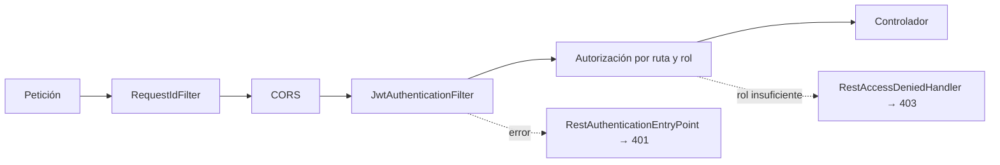

# Seguridad REST: JWT, roles y CORS

## Introducción

La API es **stateless**: no hay sesión HTTP ni cookies. Cada petición protegida trae un token JWT en `Authorization: Bearer <token>`. El adaptador de seguridad (`application.adapters.security`) valida el token, **recarga al usuario desde la base de datos** y entrega al controlador un `AuthenticatedUserPrincipal`. El dominio solo conoce los puertos `JwtServicePort` y `PasswordServicePort`; no depende de Spring Security ni de JJWT.

## Token JWT

| Claim | Contenido |
|---|---|
| `sub` | Identificador interno e inmutable del usuario |
| `jti` | Identificador único del token |
| `ver` | `User.authTokenVersion` vigente al emitir el token |
| `iat` / `exp` | Emisión y vencimiento (`jwt.expiration-ms`, por defecto 3 600 000 ms) |
| `iss` | Emisor (`jwt.issuer`, por defecto `nexusmarket`) |

- **No lleva datos personales, rol ni estado.** El rol y el estado se leen del modelo vigente en la base de datos en cada petición con `LoadAuthenticatedUserService(userId, tokenVersion)`. Así, un cambio de rol, un bloqueo o un logout surten efecto de inmediato.
- Firma **HS256** con `jwt.secret` (mínimo 32 bytes; `JwtProvider` falla al arrancar si es más corto).
- El token nunca contiene la contraseña ni el hash.

### Invalidación de sesiones

`User.authTokenVersion` se incrementa en el logout, en el cambio de estado y en cualquier cambio relevante para la seguridad. Un token con `ver` distinto del persistido es rechazado: por eso **tras un logout el token viejo deja de funcionar** y por eso no hace falta lista de revocación.

## Cadena de filtros

1. **`RequestIdFilter`** (orden más alto): acepta `X-Request-Id` o genera un UUID, lo coloca como atributo de la petición, lo devuelve en la cabecera de respuesta y lo incluye en el cuerpo de todo error.
2. **CORS** (ver abajo).
3. **`JwtAuthenticationFilter`**: lee el `Bearer`, valida firma y expiración, extrae `sub` y `ver`, carga al usuario con `SecurityUserLoader`. Si el token es inválido, está vencido o su versión no coincide, **limpia el contexto de seguridad** y deja que el punto de entrada responda 401. Si la base de datos no está disponible responde un **503** `DEPENDENCY_UNAVAILABLE`. No es un `@Bean` (se instancia dentro de `SecurityConfig`) para que Spring no lo registre dos veces como filtro de servlet.
4. **Reglas de autorización** de `SecurityConfig` (tabla siguiente).

## Reglas de autorización

| Ruta | Acceso |
|---|---|
| `OPTIONS /**` | Público (preflight CORS) |
| `POST /api/v1/auth/login`, `POST /api/v1/auth/register/**` | Público |
| `GET /api/v1/catalog/**` | Público |
| `/actuator/health/**`, `/actuator/info` | Público |
| `POST /api/v1/auth/logout` | Cualquier usuario autenticado |
| `/api/v1/buyer/**` | Rol `BUYER` |
| `/api/v1/seller/**` | Rol `SELLER` |
| `/api/v1/logistic-operator/**` | Rol `LOGISTIC_OPERATOR` |
| `/api/v1/admin/**` | Rol `ADMIN` |
| `/api/v1/supervisor/**` | Rol `SUPERVISOR` |
| Cualquier otra | Autenticada (denegada por defecto) |

- La autoridad de Spring es `ROLE_<code>` del rol de dominio (`SystemRole`), tomada del usuario cargado, nunca del token.
- La autorización por **rol y ruta** es la primera barrera; la segunda está en los servicios de dominio (`AuthorizeOperationService`, propiedad del recurso), de modo que el dominio es seguro aunque se invoque desde otro adaptador. Eso materializa RG-03.
- `csrf` deshabilitado (API sin cookies), `anonymous` deshabilitado y política de sesión `STATELESS`.
- Se registra un `UserDetailsService` que **siempre rechaza** (`UsernameNotFoundException`) para que Spring Boot no genere un usuario por defecto con contraseña aleatoria.

## Respuestas de error de seguridad

`RestAuthenticationEntryPoint` (401 `AUTHENTICATION_REQUIRED`), `RestAccessDeniedHandler` (403 `FORBIDDEN`) y el 503 del filtro usan `SecurityErrorResponseWriter`, que arma el **mismo sobre JSON** que `GlobalExceptionHandler` (`timestamp`, `status`, `code`, `message`, `path`, `requestId`, `details`) porque estos errores ocurren antes de llegar a los controladores y no pasan por `@RestControllerAdvice`.

## Contraseñas

- `BCryptPasswordServiceAdapter` implementa `PasswordServicePort` con BCrypt.
- Política (`ValidatePasswordPolicyService`): 8 a 100 caracteres con al menos una letra y un dígito.
- La contraseña en claro (`rawPassword`) es transitoria: viaja del DTO al servicio y se descarta; nunca se persiste, se devuelve ni se audita.
- Un correo desconocido y una contraseña errónea producen la **misma** respuesta (401 `INVALID_CREDENTIALS`) para no revelar si el correo existe.

## CORS

| Elemento | Valor |
|---|---|
| Origen permitido | **Uno solo**, de la variable `FRONTEND_ORIGIN` (por defecto `http://localhost:5173`) |
| Comodín `*` | **Prohibido**: la aplicación falla al arrancar si se configura |
| Métodos | `GET`, `POST`, `PUT`, `PATCH`, `DELETE`, `OPTIONS` |
| Cabeceras permitidas | `Authorization`, `Content-Type`, `Accept`, `X-Request-Id` |
| Cabeceras expuestas | `X-Request-Id` |
| `allowCredentials` | `false` (el token viaja en cabecera, no en cookie) |
| Caché del *preflight* | 3600 s |

## Variables de configuración relacionadas

| Propiedad | Variable de entorno | Por defecto |
|---|---|---|
| `jwt.secret` | `JWT_SECRET` | secreto de desarrollo (**cámbielo fuera de local**) |
| `jwt.expiration-ms` | `JWT_EXPIRATION_MS` | `3600000` |
| `jwt.issuer` | `JWT_ISSUER` | `nexusmarket` |
| origen CORS | `FRONTEND_ORIGIN` | `http://localhost:5173` |
