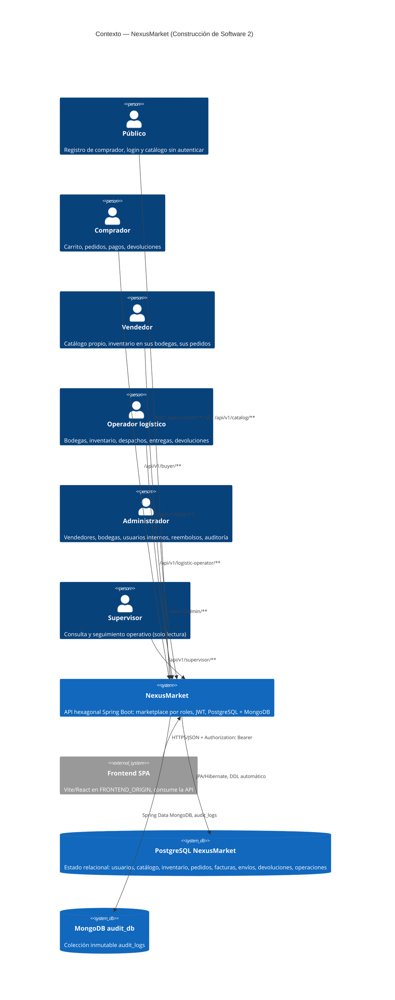

# C4 Nivel 1 — Contexto

## Propósito

Delimitar qué es el sistema, quién lo usa y con qué sistemas externos se relaciona. Todo el comportamiento del marketplace vive dentro del sistema; fuera solo hay actores humanos (vía frontend), las bases de datos y el navegador.

## Diagrama

## Actores y endpoints (resumen)

| Actor | Prefijo | Autenticación | Operaciones |
|---|---|---|---|
| Público | `/api/v1/auth`, `/api/v1/catalog` | No (login/registro/catálogo) + logout con JWT | `POST /login`, `POST /logout`, `POST /register/buyer`, `POST /register/user`, `GET /catalog/products[/{id}]` |
| Comprador | `/api/v1/buyer` | `ROLE_BUYER` | Perfil y direcciones, carrito, pedidos (crear, pagar, cancelar), factura, envío, devoluciones, reembolsos, operaciones |
| Vendedor | `/api/v1/seller` | `ROLE_SELLER` | Productos (registrar, editar, variantes, publicar, suspender, descontinuar), bodegas propias, ingresos de inventario, pedidos propios, operaciones |
| Operador logístico | `/api/v1/logistic-operator` | `ROLE_LOGISTIC_OPERATOR` | Bodegas, inventario (ingreso, ajuste, dañado, disponible), movimientos, pedidos, envíos (despachar, entregar), devoluciones (recibir, rechazar), operaciones |
| Administrador | `/api/v1/admin` | `ROLE_ADMIN` | Vendedores y sus usuarios, usuarios internos, estados de usuario/comprador/bodega, bodegas, reembolsos (aprobar, rechazar), auditoría, operaciones, resumen |
| Supervisor | `/api/v1/supervisor` | `ROLE_SUPERVISOR` | Resumen, usuarios, productos, bodegas, inventario, pedidos, envíos, reembolsos, auditoría, operaciones (todo en lectura) |

Detalle método por método: `11-endpoints-flujos.md`.
