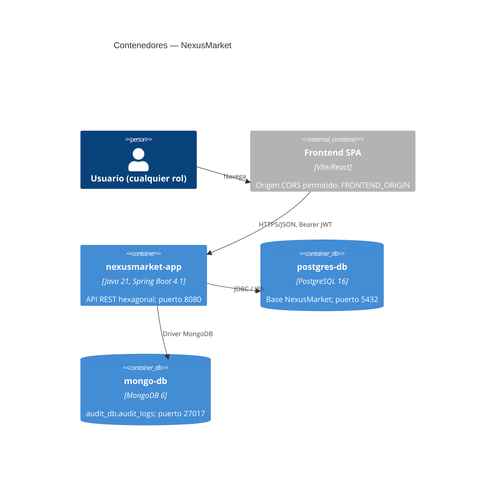

# C4 Nivel 2 — Contenedores

## Propósito

Mostrar las piezas desplegables y cómo se comunican.

## Diagrama

## Contenedores (`docker-compose.yml`)

| Servicio | Imagen | Puerto | Datos | Salud |
|---|---|---|---|---|
| `postgres-db` | `postgres:16` | 5432 | Volumen `postgres_data` | `pg_isready` |
| `mongo-db` | `mongo:6.0` | 27017 | Volumen `mongo_data` | `db.adminCommand('ping')` |
| `nexusmarket-app` | Construida desde `./nexusmarket/Dockerfile` (Maven + Temurin 21) | 8080 (`HOST_SERVER_PORT`) | Código montado en `/workspace`, caché Maven en volumen | `GET /actuator/health` |

`nexusmarket-app` solo arranca cuando ambas bases están sanas (`depends_on … service_healthy`).

## Variables de entorno de la aplicación

| Variable | Valor por defecto en Compose | Uso |
|---|---|---|
| `DB_URL` | `jdbc:postgresql://postgres-db:5432/NexusMarket` | JDBC |
| `DB_USER` / `DB_PASSWORD` | `postgres` / `postgres` | Credenciales PostgreSQL |
| `MONGODB_URI` | `mongodb://mongo-db:27017/audit_db` | Auditoría |
| `JWT_SECRET` | secreto de desarrollo | Firma HS256 (**cambiar fuera de local**) |
| `JWT_EXPIRATION_MS` | `3600000` | Vigencia del token |
| `FRONTEND_ORIGIN` | `http://localhost:5173` | Único origen CORS |
| `SEED_ENABLED` | `true` | Datos de demostración |

## Almacenes

- **PostgreSQL** guarda el estado de negocio y las `operations`. Hibernate crea y actualiza las tablas (`ddl-auto=update`).
- **MongoDB** guarda el `AuditLog` inmutable. **No comparte transacción con PostgreSQL** (ver `Adapters/Persistence-adapters.md`).
