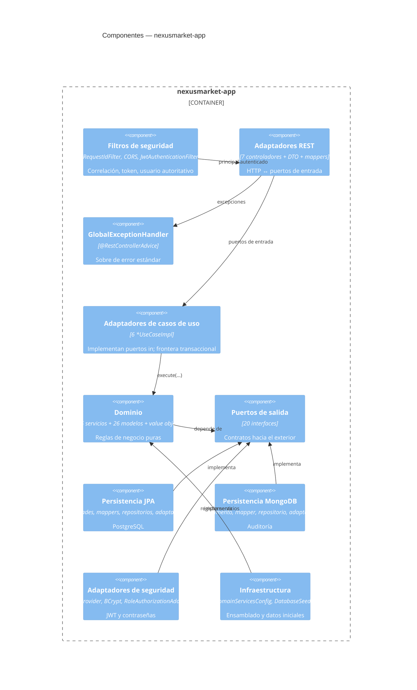
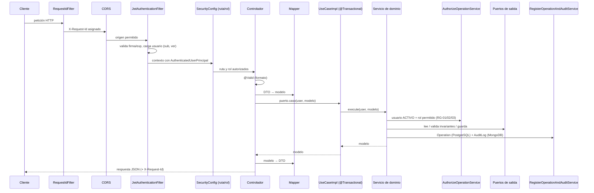

# C4 Nivel 3 — Componentes

## Propósito

Descomponer el contenedor `nexusmarket-app` en sus componentes internos y mostrar el ciclo de vida de una petición.

## Diagrama

## Ciclo de vida de una petición

Cualquier excepción en `Ctl`, `UC` o `Svc` la captura `GlobalExceptionHandler`; los fallos de `JWT`/`SC` los escribe `SecurityErrorResponseWriter` con el mismo sobre.
