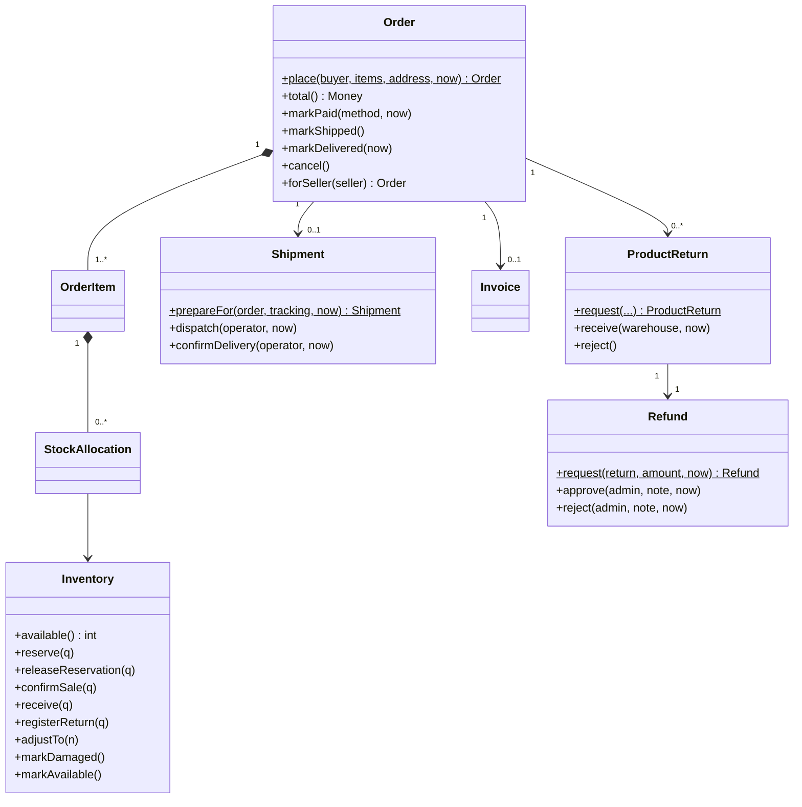
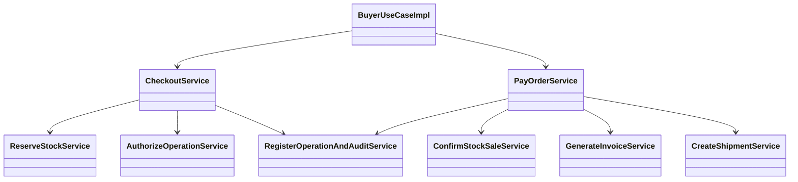
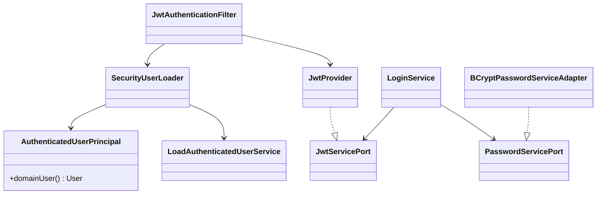
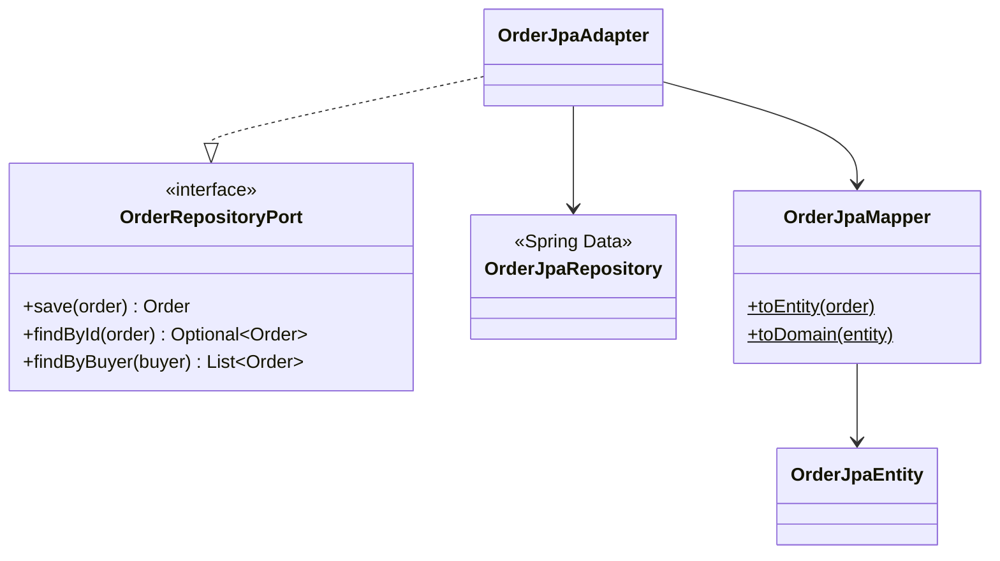

# C4 Nivel 4 — Código

## Propósito

Mostrar las clases clave y sus colaboraciones. Es un recorte: solo lo que participa en los flujos principales, no el 100 % del código.

## Dominio: pedido, inventario y envío

## Servicios del flujo de compra

## Autenticación

## Persistencia (patrón repetido en los 14 repositorios JPA)

