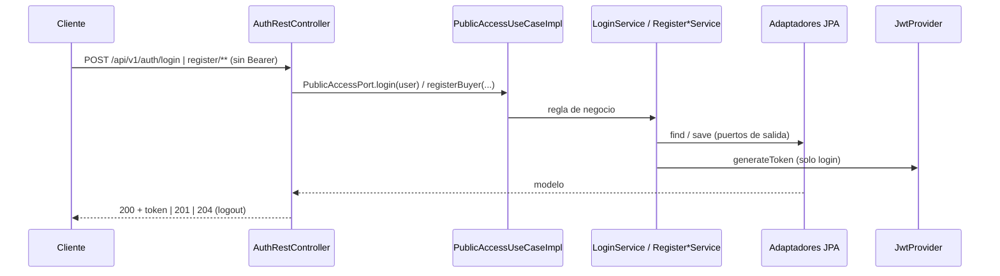
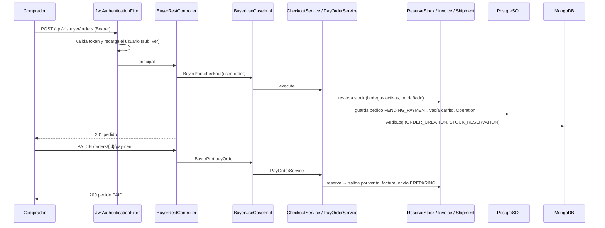
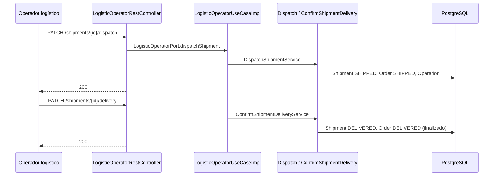
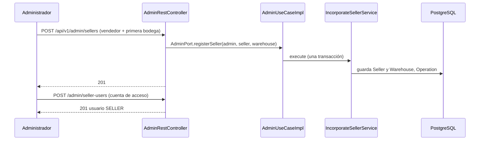

# Flujos por endpoint (todos los niveles)

Matriz generada a partir de `adapters/rest/controllers/*.java`. Para cada endpoint: transporte (L2) → componentes (L3) → clases (L4) → comportamiento. Los diagramas de secuencia muestran el camino feliz; los errores están en la tabla final y en `Adapters/Global-exception-handler.md`.

## 1. Acceso público — autenticación y registro — `AuthRestController` (PublicAccessPort)

| Método | Path | Puerto `in` → Servicio | Puertos `out` | DTOs | OK |
|---|---|---|---|---|---|
| `POST` | `/auth/login` | `login` → `LoginService` | `UserRepositoryPort`, `PasswordServicePort`, `JwtServicePort` | `LoginRequestDTO` → `LoginResponseDTO` | `200` |
| `POST` | `/auth/logout` | `logout` → `LogoutService` | `UserRepositoryPort` | `void` | `204` |
| `POST` | `/auth/register/buyer` | `registerBuyerAccount` → `RegisterBuyerAccountService` | `BuyerRepositoryPort`, `UserRepositoryPort`, `PasswordServicePort` | `RegisterBuyerRequestDTO` → `BuyerResponseDTO` | `201` |
| `POST` | `/auth/register/user` | `registerBuyerUser` → `RegisterBuyerUserService` | `BuyerRepositoryPort`, `UserRepositoryPort`, `PasswordServicePort` | `RegisterUserRequestDTO` → `UserResponseDTO` | `201` |

---

## 2. Catálogo público — `PublicCatalogRestController` (PublicAccessPort)

| Método | Path | Puerto `in` → Servicio | Puertos `out` | DTOs | OK |
|---|---|---|---|---|---|
| `GET` | `/catalog/products` | `consultPublishedProducts` → `ConsultPublishedProductsService` | `ProductRepositoryPort` | `List<ProductResponseDTO>` | `200` |
| `GET` | `/catalog/products/{productId}` | `consultPublishedProduct` → `ConsultPublishedProductService` | `ProductRepositoryPort` | `ProductResponseDTO` | `200` |

---

## 3. Comprador — `BuyerRestController` (BuyerPort, rol BUYER)

| Método | Path | Puerto `in` → Servicio | Puertos `out` | DTOs | OK |
|---|---|---|---|---|---|
| `GET` | `/buyer/profile` | `consultMyProfile` → `ConsultBuyerProfileService` | `BuyerRepositoryPort` | `BuyerResponseDTO` | `200` |
| `POST` | `/buyer/addresses` | `addAddress` → `AddBuyerAddressService` | `BuyerRepositoryPort` | `AddressRequestDTO` → `BuyerResponseDTO` | `201` |
| `DELETE` | `/buyer/addresses` | `removeAddress` → `RemoveBuyerAddressService` | `BuyerRepositoryPort` | `AddressRequestDTO` → `BuyerResponseDTO` | `200` |
| `GET` | `/buyer/cart` | `consultMyCart` → `ConsultCartService` | `BuyerRepositoryPort`, `CartRepositoryPort` | `CartResponseDTO` | `200` |
| `POST` | `/buyer/cart/items` | `addItemToCart` → `AddItemToCartService` | `BuyerRepositoryPort`, `ProductRepositoryPort`, `CartRepositoryPort` | `CartItemRequestDTO` → `CartResponseDTO` | `201` |
| `PUT` | `/buyer/cart/items/{variantId}` | `updateCartItem` → `UpdateCartItemQuantityService` | `BuyerRepositoryPort`, `CartRepositoryPort` | `UpdateCartItemRequestDTO` → `CartResponseDTO` | `200` |
| `DELETE` | `/buyer/cart/items/{variantId}` | `removeCartItem` → `RemoveCartItemService` | `BuyerRepositoryPort`, `CartRepositoryPort` | `CartResponseDTO` | `200` |
| `DELETE` | `/buyer/cart` | `clearCart` → `ClearCartService` | `BuyerRepositoryPort`, `CartRepositoryPort` | `CartResponseDTO` | `200` |
| `POST` | `/buyer/orders` | `checkout` → `CheckoutService` | `BuyerRepositoryPort`, `CartRepositoryPort`, `ProductRepositoryPort`, `InventoryRepositoryPort`, `InventoryMovementRepositoryPort`, `OrderRepositoryPort` | `OrderResponseDTO` | `201` |
| `PATCH` | `/buyer/orders/{orderId}/payment` | `payOrder` → `PayOrderService` | `BuyerRepositoryPort`, `OrderRepositoryPort`, `InventoryRepositoryPort`, `InventoryMovementRepositoryPort`, `InvoiceRepositoryPort`, `BusinessConfigurationPort`, `ShipmentRepositoryPort` | `PayOrderRequestDTO` → `OrderResponseDTO` | `200` |
| `PATCH` | `/buyer/orders/{orderId}/cancel` | `cancelOrder` → `CancelOrderService` | `BuyerRepositoryPort`, `OrderRepositoryPort`, `InventoryRepositoryPort`, `InventoryMovementRepositoryPort` | `OrderResponseDTO` | `200` |
| `GET` | `/buyer/orders` | `consultMyOrders` → `ConsultBuyerOrdersService` | `BuyerRepositoryPort`, `OrderRepositoryPort` | `List<OrderResponseDTO>` | `200` |
| `GET` | `/buyer/orders/{orderId}` | `consultMyOrder` → `FindBuyerOrderService` | `BuyerRepositoryPort`, `OrderRepositoryPort` | `OrderResponseDTO` | `200` |
| `GET` | `/buyer/orders/{orderId}/invoice` | `consultMyInvoice` → `ConsultOrderInvoiceService` | `BuyerRepositoryPort`, `OrderRepositoryPort`, `InvoiceRepositoryPort` | `InvoiceResponseDTO` | `200` |
| `GET` | `/buyer/orders/{orderId}/shipment` | `consultMyShipment` → `ConsultOrderShipmentService` | `BuyerRepositoryPort`, `OrderRepositoryPort`, `ShipmentRepositoryPort` | `ShipmentResponseDTO` | `200` |
| `POST` | `/buyer/returns` | `requestReturn` → `RequestReturnService` | `BuyerRepositoryPort`, `OrderRepositoryPort`, `ProductReturnRepositoryPort`, `RefundRepositoryPort`, `BusinessConfigurationPort` | `RequestReturnRequestDTO` → `ReturnRequestResponseDTO` | `201` |
| `GET` | `/buyer/returns` | `consultMyReturns` → `ConsultBuyerReturnsService` | `BuyerRepositoryPort`, `ProductReturnRepositoryPort` | `List<ProductReturnResponseDTO>` | `200` |
| `GET` | `/buyer/refunds` | `consultMyRefunds` → `ConsultBuyerRefundsService` | `BuyerRepositoryPort`, `RefundRepositoryPort` | `List<RefundResponseDTO>` | `200` |
| `GET` | `/buyer/operations` | `consultMyOperations` → `ConsultUserOperationsService` | `OperationRepositoryPort` | `List<OperationResponseDTO>` | `200` |

---

## 4. Vendedor — `SellerRestController` (SellerPort, rol SELLER)

| Método | Path | Puerto `in` → Servicio | Puertos `out` | DTOs | OK |
|---|---|---|---|---|---|
| `POST` | `/seller/products` | `registerProduct` → `RegisterProductService` | `SellerRepositoryPort`, `ProductRepositoryPort` | `RegisterProductRequestDTO` → `ProductResponseDTO` | `201` |
| `PUT` | `/seller/products/{productId}` | `updateProduct` → `UpdateProductService` | `ProductRepositoryPort` | `UpdateProductRequestDTO` → `ProductResponseDTO` | `200` |
| `POST` | `/seller/products/{productId}/variants` | `addProductVariant` → `AddProductVariantService` | `ProductRepositoryPort` | `ProductVariantRequestDTO` → `ProductResponseDTO` | `201` |
| `PATCH` | `/seller/products/{productId}/publish` | `publishProduct` → `PublishProductService` | `ProductRepositoryPort` | `ProductResponseDTO` | `200` |
| `PATCH` | `/seller/products/{productId}/suspend` | `suspendProduct` → `SuspendProductService` | `ProductRepositoryPort` | `ProductResponseDTO` | `200` |
| `PATCH` | `/seller/products/{productId}/discontinue` | `discontinueProduct` → `DiscontinueProductService` | `ProductRepositoryPort` | `ProductResponseDTO` | `200` |
| `GET` | `/seller/products` | `consultMyProducts` → `ConsultSellerProductsService` | `SellerRepositoryPort`, `ProductRepositoryPort` | `List<ProductResponseDTO>` | `200` |
| `GET` | `/seller/warehouses` | `consultMyWarehouses` → `ConsultSellerWarehousesService` | `SellerRepositoryPort`, `WarehouseRepositoryPort` | `List<WarehouseResponseDTO>` | `200` |
| `POST` | `/seller/inventory/inflows` | `registerInventoryInflow` → `RegisterInventoryInflowService` | `ProductRepositoryPort`, `WarehouseRepositoryPort`, `InventoryRepositoryPort`, `InventoryMovementRepositoryPort` | `InventoryInflowRequestDTO` → `InventoryResponseDTO` | `201` |
| `GET` | `/seller/inventory` | `consultMyInventory` → `ConsultSellerInventoryService` | `SellerRepositoryPort`, `InventoryRepositoryPort` | `List<InventoryResponseDTO>` | `200` |
| `GET` | `/seller/orders` | `consultMyOrders` → `ConsultSellerOrdersService` | `SellerRepositoryPort`, `OrderRepositoryPort` | `List<OrderResponseDTO>` | `200` |
| `GET` | `/seller/orders/{orderId}` | `consultMyOrder` → `ConsultSellerOrderService` | `OrderRepositoryPort` | `OrderResponseDTO` | `200` |
| `GET` | `/seller/operations` | `consultMyOperations` → `ConsultUserOperationsService` | `OperationRepositoryPort` | `List<OperationResponseDTO>` | `200` |

---

## 5. Operador logístico — `LogisticOperatorRestController` (LogisticOperatorPort, rol LOGISTIC_OPERATOR)

| Método | Path | Puerto `in` → Servicio | Puertos `out` | DTOs | OK |
|---|---|---|---|---|---|
| `GET` | `/logistic-operator/warehouses` | `consultWarehouses` → `ConsultWarehousesService` | `WarehouseRepositoryPort` | `List<WarehouseResponseDTO>` | `200` |
| `GET` | `/logistic-operator/warehouses/{warehouseId}/inventory` | `consultWarehouseInventory` → `ConsultWarehouseInventoryService` | `WarehouseRepositoryPort`, `InventoryRepositoryPort` | `List<InventoryResponseDTO>` | `200` |
| `GET` | `/logistic-operator/inventory/{inventoryId}/movements` | `consultInventoryMovements` → `ConsultInventoryMovementsService` | `InventoryRepositoryPort`, `InventoryMovementRepositoryPort` | `List<InventoryMovementResponseDTO>` | `200` |
| `POST` | `/logistic-operator/inventory/inflows` | `registerInventoryInflow` → `RegisterInventoryInflowService` | `ProductRepositoryPort`, `WarehouseRepositoryPort`, `InventoryRepositoryPort`, `InventoryMovementRepositoryPort` | `InventoryInflowRequestDTO` → `InventoryResponseDTO` | `201` |
| `PATCH` | `/logistic-operator/inventory/{inventoryId}/adjustment` | `adjustInventory` → `AdjustInventoryService` | `InventoryRepositoryPort`, `InventoryMovementRepositoryPort` | `InventoryAdjustmentRequestDTO` → `InventoryResponseDTO` | `200` |
| `PATCH` | `/logistic-operator/inventory/{inventoryId}/damaged` | `markInventoryDamaged` → `MarkInventoryDamagedService` | `InventoryRepositoryPort` | `InventoryResponseDTO` | `200` |
| `PATCH` | `/logistic-operator/inventory/{inventoryId}/available` | `markInventoryAvailable` → `MarkInventoryAvailableService` | `InventoryRepositoryPort` | `InventoryResponseDTO` | `200` |
| `GET` | `/logistic-operator/orders` | `consultOrders` → `ConsultAllOrdersService` | `OrderRepositoryPort` | `List<OrderResponseDTO>` | `200` |
| `GET` | `/logistic-operator/orders/{orderId}` | `consultOrder` → `ConsultOrderService` | `OrderRepositoryPort` | `OrderResponseDTO` | `200` |
| `GET` | `/logistic-operator/shipments` | `consultShipments` → `ConsultShipmentsService` | `ShipmentRepositoryPort` | `List<ShipmentResponseDTO>` | `200` |
| `PATCH` | `/logistic-operator/shipments/{shipmentId}/dispatch` | `dispatchShipment` → `DispatchShipmentService` | `ShipmentRepositoryPort`, `OrderRepositoryPort` | `ShipmentResponseDTO` | `200` |
| `PATCH` | `/logistic-operator/shipments/{shipmentId}/delivery` | `confirmDelivery` → `ConfirmShipmentDeliveryService` | `ShipmentRepositoryPort`, `OrderRepositoryPort` | `ShipmentResponseDTO` | `200` |
| `GET` | `/logistic-operator/returns` | `consultReturnsToReceive` → `ConsultReturnsToReceiveService` | `ProductReturnRepositoryPort` | `List<ProductReturnResponseDTO>` | `200` |
| `PATCH` | `/logistic-operator/returns/{returnId}/reception` | `receiveReturn` → `ReceiveReturnService` | `ProductReturnRepositoryPort`, `WarehouseRepositoryPort`, `InventoryRepositoryPort`, `InventoryMovementRepositoryPort` | `ReceiveReturnRequestDTO` → `ProductReturnResponseDTO` | `200` |
| `PATCH` | `/logistic-operator/returns/{returnId}/rejection` | `rejectReturn` → `RejectReturnService` | `ProductReturnRepositoryPort`, `RefundRepositoryPort` | `ProductReturnResponseDTO` | `200` |
| `GET` | `/logistic-operator/operations` | `consultMyOperations` → `ConsultUserOperationsService` | `OperationRepositoryPort` | `List<OperationResponseDTO>` | `200` |

---

## 6. Administrador — `AdminRestController` (AdminPort, rol ADMIN)

| Método | Path | Puerto `in` → Servicio | Puertos `out` | DTOs | OK |
|---|---|---|---|---|---|
| `POST` | `/admin/sellers` | `registerSeller` → `IncorporateSellerService` | `SellerRepositoryPort`, `UserRepositoryPort`, `WarehouseRepositoryPort` | `RegisterSellerRequestDTO` → `SellerResponseDTO` | `201` |
| `POST` | `/admin/seller-users` | `registerSellerUser` → `RegisterSellerUserService` | `SellerRepositoryPort`, `UserRepositoryPort`, `PasswordServicePort` | `RegisterSellerUserRequestDTO` → `UserResponseDTO` | `201` |
| `POST` | `/admin/staff-users` | `registerStaffUser` → `RegisterStaffUserService` | `UserRepositoryPort`, `PasswordServicePort` | `RegisterStaffUserRequestDTO` → `UserResponseDTO` | `201` |
| `GET` | `/admin/users` | `consultUsers` → `ConsultUsersService` | `UserRepositoryPort` | `List<UserResponseDTO>` | `200` |
| `PATCH` | `/admin/users/{userId}/status` | `changeUserStatus` → `ChangeUserStatusService` | `UserRepositoryPort` | `ChangeStatusRequestDTO` → `UserResponseDTO` | `200` |
| `PATCH` | `/admin/buyers/{buyerId}/status` | `changeBuyerStatus` → `ChangeBuyerStatusService` | `BuyerRepositoryPort` | `ChangeStatusRequestDTO` → `BuyerResponseDTO` | `200` |
| `POST` | `/admin/warehouses` | `createWarehouse` → `CreateWarehouseService` | `WarehouseRepositoryPort`, `SellerRepositoryPort` | `CreateWarehouseRequestDTO` → `WarehouseResponseDTO` | `201` |
| `PUT` | `/admin/warehouses/{warehouseId}` | `updateWarehouse` → `UpdateWarehouseService` | `WarehouseRepositoryPort` | `UpdateWarehouseRequestDTO` → `WarehouseResponseDTO` | `200` |
| `PATCH` | `/admin/warehouses/{warehouseId}/status` | `changeWarehouseStatus` → `ChangeWarehouseStatusService` | `WarehouseRepositoryPort` | `ChangeStatusRequestDTO` → `WarehouseResponseDTO` | `200` |
| `GET` | `/admin/warehouses` | `consultWarehouses` → `ConsultWarehousesService` | `WarehouseRepositoryPort` | `List<WarehouseResponseDTO>` | `200` |
| `GET` | `/admin/refunds/pending` | `consultPendingRefunds` → `ConsultRefundsService` | `RefundRepositoryPort` | `List<RefundResponseDTO>` | `200` |
| `PATCH` | `/admin/refunds/{refundId}/approval` | `approveRefund` → `ApproveRefundService` | `RefundRepositoryPort`, `ProductReturnRepositoryPort` | `RefundResponseDTO` | `200` |
| `PATCH` | `/admin/refunds/{refundId}/rejection` | `rejectRefund` → `RejectRefundService` | `RefundRepositoryPort`, `ProductReturnRepositoryPort` | `RefundResponseDTO` | `200` |
| `GET` | `/admin/audit-logs` | `consultAuditLog` → `ConsultAuditLogsService` | `AuditLogRepositoryPort` | `AuditLogPageResponseDTO` | `200` |
| `GET` | `/admin/operations` | `consultAllOperations` → `ConsultAllOperationsService` | `OperationRepositoryPort` | `List<OperationResponseDTO>` | `200` |
| `GET` | `/admin/summary` | `consultSummary` → `ConsultAdministrativeSummaryService` | `UserRepositoryPort`, `OrderRepositoryPort`, `ProductRepositoryPort`, `ShipmentRepositoryPort`, `RefundRepositoryPort`, `InventoryRepositoryPort` | `AdministrativeSummaryResponseDTO` | `200` |

---

## 7. Supervisor — `SupervisorRestController` (SupervisorPort, rol SUPERVISOR)

| Método | Path | Puerto `in` → Servicio | Puertos `out` | DTOs | OK |
|---|---|---|---|---|---|
| `GET` | `/supervisor/summary` | `consultSummary` → `ConsultAdministrativeSummaryService` | `UserRepositoryPort`, `OrderRepositoryPort`, `ProductRepositoryPort`, `ShipmentRepositoryPort`, `RefundRepositoryPort`, `InventoryRepositoryPort` | `AdministrativeSummaryResponseDTO` | `200` |
| `GET` | `/supervisor/users` | `consultUsers` → `ConsultUsersService` | `UserRepositoryPort` | `List<UserResponseDTO>` | `200` |
| `GET` | `/supervisor/products` | `consultProducts` → `ConsultAllProductsService` | `ProductRepositoryPort` | `List<ProductResponseDTO>` | `200` |
| `GET` | `/supervisor/warehouses` | `consultWarehouses` → `ConsultWarehousesService` | `WarehouseRepositoryPort` | `List<WarehouseResponseDTO>` | `200` |
| `GET` | `/supervisor/warehouses/{warehouseId}/inventory` | `consultWarehouseInventory` → `ConsultWarehouseInventoryService` | `WarehouseRepositoryPort`, `InventoryRepositoryPort` | `List<InventoryResponseDTO>` | `200` |
| `GET` | `/supervisor/orders` | `consultOrders` → `ConsultAllOrdersService` | `OrderRepositoryPort` | `List<OrderResponseDTO>` | `200` |
| `GET` | `/supervisor/orders/{orderId}` | `consultOrder` → `ConsultOrderService` | `OrderRepositoryPort` | `OrderResponseDTO` | `200` |
| `GET` | `/supervisor/shipments` | `consultShipments` → `ConsultShipmentsService` | `ShipmentRepositoryPort` | `List<ShipmentResponseDTO>` | `200` |
| `GET` | `/supervisor/refunds` | `consultRefunds` → `ConsultRefundsService` | `RefundRepositoryPort` | `List<RefundResponseDTO>` | `200` |
| `GET` | `/supervisor/audit-logs` | `consultAuditLog` → `ConsultAuditLogsService` | `AuditLogRepositoryPort` | `AuditLogPageResponseDTO` | `200` |
| `GET` | `/supervisor/operations` | `consultAllOperations` → `ConsultAllOperationsService` | `OperationRepositoryPort` | `List<OperationResponseDTO>` | `200` |

---

## 8. Errores comunes a todos los endpoints

| HTTP | `code` | Causa |
|---|---|---|
| 400 | `INVALID_REQUEST` / `INVALID_<ENTIDAD>` | Validación de formato o de dominio |
| 401 | `AUTHENTICATION_REQUIRED` / `INVALID_CREDENTIALS` | Sin token, token inválido/obsoleto o credenciales erróneas |
| 403 | `FORBIDDEN` | Rol insuficiente o recurso de otro participante |
| 404 | `RESOURCE_NOT_FOUND` | El recurso no existe |
| 409 | `RESOURCE_ALREADY_EXISTS`, `INVALID_STATE_TRANSITION`, `INSUFFICIENT_STOCK`, `DAMAGED_INVENTORY` | Conflicto de negocio |
| 503 | `DEPENDENCY_UNAVAILABLE` | PostgreSQL o MongoDB no disponible |
