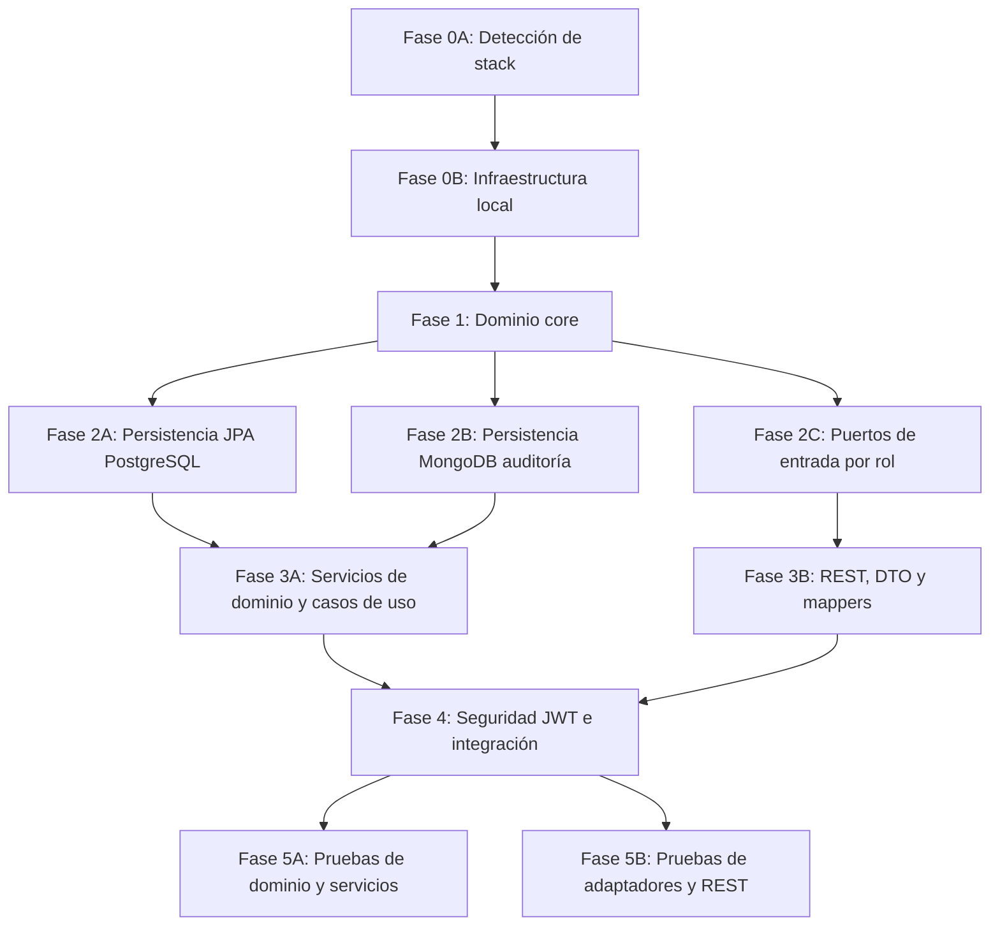

# PROMPT DE ORQUESTACIÓN AGÉNTICA: DESARROLLO DE CÓDIGO PARALELIZADO BASADO EN SDD — NEXUSMARKET

Este documento define el **Prompt del Agente Orquestador (Master Coordinator)** encargado de dirigir agentes especializados para implementar de forma automatizada y paralelizada el código fuente de **NexusMarket**, siguiendo estrictamente el **Software Design Document (SDD)**, la **Arquitectura Hexagonal (DDD + Ports & Adapters)** y la infraestructura local con **PostgreSQL (5432)** y **MongoDB (27017)**.

Este perfil es exclusivamente **Java con Spring Boot, Spring Security, Spring Data JPA y Spring Data MongoDB**. La detección de otro lenguaje o framework no autoriza cambiar de stack: debe registrarse como incompatibilidad y detenerse la implementación hasta aclarar el repositorio.

**Reglas de idioma:** la documentación del `SDD/` está en español; **el código Java está 100 % en inglés** (clases, atributos, métodos, paquetes).

---

## 1. IDENTIFICACIÓN Y CONFIGURACIÓN DEL AGENTE ORQUESTADOR

- **Rol:** Agente Orquestador Principal / Lead Software Architect.
- **Objetivo:** Diagnosticar el estado del repositorio y ejecutar el siguiente trabajo necesario para implementar el marketplace en Java/Spring cumpliendo los contratos de `SDD/`. Reanudar el trabajo existente sin regenerar componentes verificados; paralelizar solo tareas independientes.
- **Entorno local auto-generado:**
  - **Relacional (SQL):** PostgreSQL en el puerto **`5432`** (base `NexusMarket`; credenciales por variables de entorno `DB_USER` / `DB_PASSWORD`).
  - **NoSQL (auditoría):** MongoDB en el puerto **`27017`** (base `audit_db`, colección `audit_logs`).
  - **Aplicación:** Java 25 (LTS), Spring Boot 4.1 y Spring Security.
  - **Persistencia relacional:** Spring Data JPA / Hibernate.
  - **Auditoría NoSQL:** Spring Data MongoDB.
  - **Build:** Maven.
- **Fuentes de verdad, en este orden:** `SDD/especificacion_funcional_nexusmarket.md` → `SDD/enunciado.md` → `SDD/domain/**` → `SDD/Adapters/**` → `SDD/Software Architecture/**` → `SDD/C4/**`.
- **Principio rector:** **Responsabilidad Única.** Un servicio de dominio = un caso de uso o una regla reutilizable; cada uno debe poder justificarse en una frase.

---

## 2. MAPA DE PARALELIZACIÓN Y DEPENDENCIAS POR FASES



---

## 3. INSTRUCCIONES EJECUTIVAS PARA EL AGENTE ORQUESTADOR

### FASE 0A: Auto-detección del lenguaje y stack
1. Confirmar Java mediante `pom.xml` y localizar el punto de entrada Spring Boot y las dependencias de Spring Security, Spring Data JPA y Spring Data MongoDB.
2. Si el repositorio está vacío, inicializar Java/Spring Boot conforme a este SDD.
3. Si el repositorio contiene otro stack, registrar `STACK_MISMATCH`, documentar la evidencia y detenerse.
4. No se permite auto-seleccionar TypeScript, NestJS, Express, TypeORM, Prisma ni Mongoose.

---

### FASE 0B: Infraestructura y configuración local
1. Crear `docker-compose.yml` en la raíz con PostgreSQL `5432:5432` y MongoDB `27017:27017`.
2. Crear `application.properties` con: URL PostgreSQL (`jdbc:postgresql://postgres-db:5432/NexusMarket` en Compose; `localhost` en ejecución directa), auto-DDL, URI MongoDB (`mongodb://mongo-db:27017/audit_db`) y parámetros JWT/CORS/negocio (sección 4).

---

### FASE 1: Agente de dominio core (ejecución única / secuencial)
**Sub-agente:** `domain-core-agent`
**Objetivo:** construir la capa de dominio pura, libre de Spring e infraestructura.

**Entregables:**
- Modelos en `domain/models/` (ver `SDD/domain/Domain Model.md`): `MarketplaceResource`, `Person`, `User`, `Buyer`, `Seller`, `Warehouse`, `Product`, `ProductVariant`, `Inventory`, `InventoryMovement`, `StockAllocation`, `Cart`, `CartItem`, `Order`, `OrderItem`, `Invoice`, `Shipment`, `ProductReturn`, `Refund`, `Operation`, `AuditLog`, etc.
- Value Objects en `domain/valueobjects/` (ver `SDD/domain/Domain Value Objects.md`): catálogos `SystemRole`, `UserStatus`, `BuyerStatus`, `WarehouseType`, `WarehouseStatus`, `ProductType`, `ProductStatus`, `InventoryStatus`, `MovementType`, `OrderStatus`, `PaymentMethod`, `ShipmentStatus`, `ReturnReason`, `ReturnStatus`, `RefundStatus`, `Currency`, `OperationType`, más `Money` y `Address`. **Cero `String` abiertos en campos acotados.**
- Enums técnicos en `domain/enums/`: `AuditSeverity`, `NotificationChannel`, `ApprovalDecision`.
- Excepciones en `domain/exceptions/`.
- Puertos de salida en `domain/ports/out/` (ver `SDD/domain/Output-ports.md`): 14 repositorios (`User`, `Buyer`, `Seller`, `Warehouse`, `Product`, `Inventory`, `InventoryMovement`, `Cart`, `Order`, `Invoice`, `Shipment`, `ProductReturn`, `Refund`, `Operation`), `AuditLogRepositoryPort`, `PasswordServicePort`, `JwtServicePort`, `AuthorizationPort`, `BusinessConfigurationPort`, `NotificationPort`.

---

### FASE 2: Adaptadores e interfaces en paralelo
El orquestador lanza **3 sub-agentes independientes**.

#### [PARALELO 2A] Persistencia relacional (PostgreSQL)
**Sub-agente:** `relational-persistence-agent`
> "Implementa la persistencia relacional exclusivamente con Spring Data JPA/Hibernate en `adapters/persistence/jpa/`: entidades `@Entity`, mappers bidireccionales, interfaces `JpaRepository` y adaptadores que implementen los puertos de salida. Sigue `SDD/Adapters/Persistence-adapters.md`; los catálogos se guardan por `code`; no introduzcas otro ORM."

#### [PARALELO 2B] Persistencia NoSQL de auditoría (MongoDB)
**Sub-agente:** `mongo-persistence-agent`
> "Implementa la auditoría exclusivamente con Spring Data MongoDB en `adapters/persistence/mongodb/`: `@Document` `AuditLogDocument` (colección `audit_logs`), mapper, `MongoRepository` y `AuditLogMongoAdapter` implementando `AuditLogRepositoryPort`. Solo-agregar; nunca guardes contraseñas en `details`."

#### [PARALELO 2C] Puertos de entrada por rol
**Sub-agente:** `input-ports-agent`
> "Crea en `domain/ports/in/` las interfaces `PublicAccessPort`, `BuyerPort`, `SellerPort`, `LogisticOperatorPort`, `AdminPort` y `SupervisorPort`. Usa los tipos de dominio y las firmas exactas de `SDD/domain/Input-ports.md`; no cambies parámetros ni semántica."

---

### FASE 3: Lógica de negocio y entrega REST en paralelo
El orquestador lanza **2 sub-agentes**.

#### [PARALELO 3A] Servicios de dominio y adaptadores de casos de uso
**Sub-agente:** `domain-services-usecases-agent`
> "Implementa los servicios de dominio en `domain/services/` (un servicio = un caso de uso, método único `execute`) aplicando reglas, validaciones, precondiciones, flujos y excepciones de `SDD/domain/Domain Services.md` y todos los documentos de `SDD/domain/services/`. Implementa en `adapters/useCases/` cada puerto de entrada, inyectando los servicios según `SDD/Adapters/Use-cases-adapters.md`. Cada servicio autoriza con `AuthorizeOperationService` y registra trazabilidad con `RegisterOperationAndAuditService`."

#### [PARALELO 3B] DTO, mappers y controladores REST
**Sub-agente:** `rest-controllers-agent`
> "Crea en `adapters/rest/`:
> 1. Todos los Request y Response DTO (records).
> 2. Mappers estáticos (`RequestDTO` ↔ `Domain Model` ↔ `ResponseDTO`).
> 3. Los 7 controladores de `SDD/Adapters/Api-rest-endpoints.md` (81 endpoints) con métodos, rutas, DTO, códigos HTTP y reglas de autorización exactos. Inyectan los puertos de entrada por rol y reciben el usuario con `@AuthenticationPrincipal`.
> 4. Validación Jakarta según `SDD/Adapters/Rest-validation.md` y manejo global con `@RestControllerAdvice` según `SDD/Adapters/Global-exception-handler.md`."

---

### FASE 4: Seguridad JWT e integración
**Sub-agente:** `security-integration-agent`
> "Implementa en `adapters/security/`:
> 1. `JwtProvider` que emita y valide JWT con `sub` (id interno inmutable), `jti`, `ver` (`User.authTokenVersion`), `iat`, `exp` e `iss`; **sin PII ni snapshots de permisos**.
> 2. `JwtAuthenticationFilter` que verifique el token, cargue por `sub` al usuario vigente mediante `LoadAuthenticatedUserService`, rechace usuarios inexistentes/inactivos/bloqueados o con `ver` obsoleto y cree un `AuthenticatedUserPrincipal` con el modelo de dominio vigente.
> 3. `SecurityConfig` (JWT sin sesión, autorización por ruta y rol) según `SDD/Adapters/Rest-security-cors.md`.
> 4. CORS con un único origen (`FRONTEND_ORIGIN`), preflight y `X-Request-Id`.
> 5. Valida compilación, pruebas de 401/403, CORS/preflight y conectividad con PostgreSQL y MongoDB."

---

### FASE 5: Pruebas unitarias automatizadas
El orquestador lanza **2 sub-agentes de pruebas** en paralelo.

#### [PARALELO 5A] Dominio y servicios
**Sub-agente:** `domain-unit-tests-agent`
> "Genera en `src/test/java/` las pruebas del dominio: modelos y value objects (invariantes), y servicios de dominio ejercitados a través de los adaptadores de casos de uso con repositorios en memoria (flujo de autenticación, catálogo e inventario, ciclo del pedido, devoluciones y reembolsos, autorización y auditoría). Valida las reglas y excepciones de `SDD/domain/services/`."

#### [PARALELO 5B] Adaptadores y REST
**Sub-agente:** `adapters-unit-tests-agent`
> "Genera las pruebas de la capa de adaptadores en `src/test/java/application/adapters/`: mapeo de errores (`ErrorCodeMapping`), mappers REST/JPA/Mongo, validación de DTO y controladores aislando los puertos de entrada con mocks."

---

## 4. CÓDIGO DE INFRAESTRUCTURA AUTO-GENERADA (CONFIGURACIÓN LOCAL)

### 4.1. `docker-compose.yml` (raíz del proyecto)
Ver el archivo del repositorio: servicios `postgres-db` (`postgres:16`), `mongo-db` (`mongo:6.0`) y `nexusmarket-app`, con *healthchecks* y `depends_on: service_healthy`.

### 4.2. `src/main/resources/application.properties`
```properties
server.port=${SERVER_PORT:8080}

# PostgreSQL
spring.datasource.url=${DB_URL:jdbc:postgresql://localhost:5432/NexusMarket}
spring.datasource.username=${DB_USER:postgres}
spring.datasource.password=${DB_PASSWORD:postgres}
spring.jpa.hibernate.ddl-auto=${JPA_DDL_AUTO:update}
spring.jpa.open-in-view=false

# MongoDB (auditoría)
spring.mongodb.uri=${MONGODB_URI:mongodb://localhost:27017/audit_db}

# Seguridad y JWT
jwt.secret=${JWT_SECRET:<valor-de-desarrollo-de-al-menos-32-bytes>}
jwt.expiration-ms=${JWT_EXPIRATION_MS:3600000}
jwt.issuer=${JWT_ISSUER:nexusmarket}

# Parámetros de negocio
nexusmarket.business.tax-rate=${BUSINESS_TAX_RATE:0.19}
nexusmarket.business.return-window-days=${BUSINESS_RETURN_WINDOW_DAYS:30}
```

---

## 5. CONTROL DE CALIDAD Y CRITERIOS DE FINALIZACIÓN

El desarrollo se declara **exitoso y completado** cuando se cumple:

1. **Compilación y pruebas limpias:** compilación sin errores y 100 % de las pruebas ejecutadas con éxito (JUnit 5).
2. **Cumplimiento estricto del SDD de servicios:** cada servicio de `domain/services/` cumple sin omisiones precondiciones, validaciones, registro de operación, auditoría e inmutabilidad definidos en `SDD/domain/`.
3. **Autocreación de tablas y colecciones:** al iniciar, el ORM crea las tablas en PostgreSQL y MongoDB crea `audit_logs` al insertar el primer evento.
4. **Desacoplamiento estricto:** `domain/` no importa Spring, JPA, MongoDB, Jackson ni HTTP.
5. **Trazabilidad completa:** cada petición convierte el `RequestDTO` a modelo, ejecuta el caso de uso con el `User` vigente cargado por el filtro JWT, el servicio aplica las reglas e invoca los puertos de salida, y el adaptador de persistencia usa su propio `Mapper` y su `Entity/Document`.
6. **Responsabilidad única:** ningún servicio de dominio resuelve más de un caso de uso.
7. **Idioma:** código Java 100 % en inglés; documentación en español.
