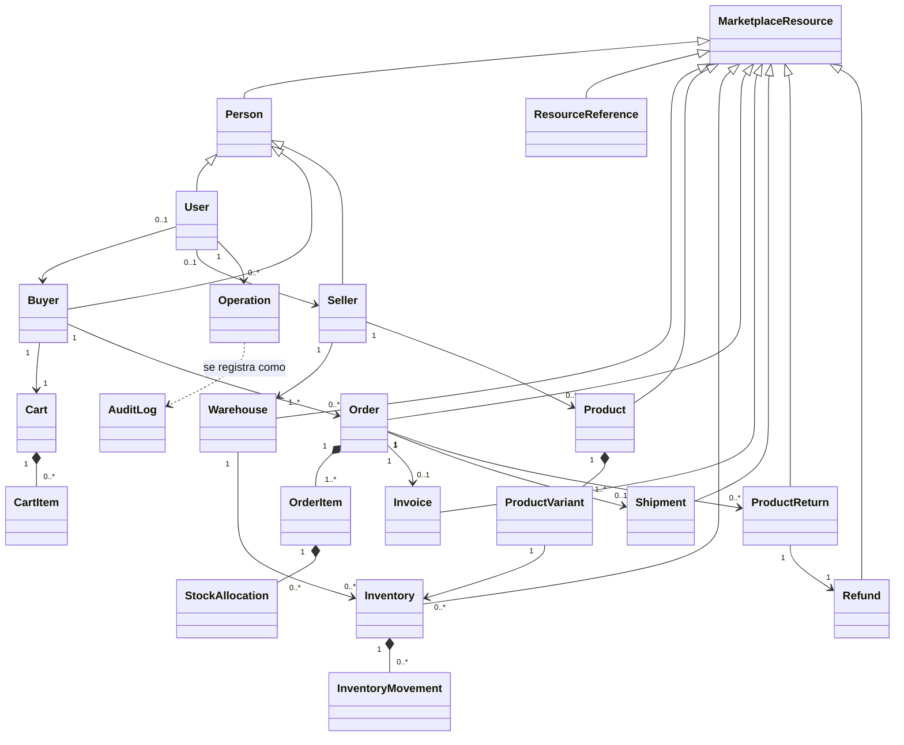

# Modelo de dominio

## Introducción

El modelo de dominio de NexusMarket está formado por **26 modelos** (clases ricas, sin anotaciones de framework ni de persistencia). Un modelo contiene su estado, sus invariantes y las transiciones válidas de su ciclo de vida; los servicios de dominio coordinan casos de uso, pero la regla «un pedido finalizado no se modifica» o «el stock no puede ser negativo» vive en el propio modelo (`Order`, `Inventory`).

## Convenciones

- Los modelos **referencian modelos, no identificadores**: `Order.buyer` es un `Buyer`, no un `Long`. Las entidades JPA guardan las llaves; los *mappers* de persistencia reconstruyen referencias ligeras (solo id) para los agregados ajenos.
- Los catálogos de negocio son *value objects* (`SystemRole`, `OrderStatus`, …), no `enum`; ver `Domain Value Objects.md`.
- Los constructores públicos sin argumentos y los *setters* existen para que los adaptadores puedan reconstruir el modelo; los cambios de negocio pasan por métodos con nombre (`reserve`, `markPaid`, `dispatch`, `approve`…).
- Los montos usan `Money`; las direcciones, `Address`.

## Diagrama de relaciones

> `MarketplaceResource` es la base de los recursos que pueden ser sujeto de una `Operation` (personas, bodegas, productos, inventarios, pedidos, facturas, envíos, devoluciones y reembolsos). `ProductVariant`, `InventoryMovement`, `Cart`, `CartItem`, `OrderItem` y `StockAllocation` son partes de un agregado y no la extienden.

---

## MarketplaceResource

*Subdominio: Base*

Base abstracta de todo recurso del marketplace que puede ser sujeto de una `Operation` (equivale al producto abstracto del dominio de referencia). Aporta `id` y `getResourceType()`.

| Atributo | Tipo |
|---|---|
| `id` | `Long` |

---

## Person

*Subdominio: Base; extiende `MarketplaceResource`*

Persona identificable abstracta: centraliza la identidad compartida por compradores, vendedores y usuarios (identificación, nombre, correo, rol).

| Atributo | Tipo |
|---|---|
| `identification` | `String` |
| `name` | `String` |
| `email` | `String` |
| `role` | `SystemRole` |

Comportamiento de dominio:

- `ensureIdentityValid()`

---

## User

*Subdominio: Usuarios; extiende `Person`*

Identidad del sistema para autenticación y autorización. Hereda identidad y rol de `Person`. Puede representar a un comprador o a un vendedor (los usuarios internos no tienen ninguno). La contraseña solo se guarda cifrada (`passwordHash`); `rawPassword` es transitoria. `authTokenVersion` se incrementa en cada cambio relevante para la seguridad y deja obsoletos los tokens ya emitidos.

| Atributo | Tipo |
|---|---|
| `passwordHash` | `String` |
| `rawPassword` | `String` |
| `status` | `UserStatus` |
| `authTokenVersion` | `long` |
| `buyer` | `Buyer` |
| `seller` | `Seller` |

Comportamiento de dominio:

- `isActive()`
- `hasRole(SystemRole expected)`
- `changeStatus(UserStatus target)`
- `bumpAuthTokenVersion()`
- `changePasswordHash(String newPasswordHash)`
- `ensureRegistrationDataComplete()`
- `requireActive()`

---

## Buyer

*Subdominio: Compradores; extiende `Person`*

Perfil comercial de quien compra: dirección principal, direcciones adicionales y estado comercial que permite o no comprar. Un comprador nunca administra la información de otros compradores.

| Atributo | Tipo |
|---|---|
| `status` | `BuyerStatus` |
| `primaryAddress` | `Address` |
| `additionalAddresses` | `List<Address>` |

Comportamiento de dominio:

- `ensureComplete()`
- `addAddress(Address address)`
- `removeAddress(Address address)`
- `ownsAddress(Address address)`
- `canPurchase()`
- `requireCanPurchase()`
- `changeStatus(BuyerStatus target)`
- `sameBuyerAs(Buyer other)`

---

## Seller

*Subdominio: Vendedores; extiende `Person`*

Perfil comercial de un vendedor. Los vendedores no se autorregistran: los incorpora el Administrador junto con su primera bodega.

| Atributo | Tipo |
|---|---|
| `businessName` | `String` |

Comportamiento de dominio:

- `ensureComplete()`
- `sameSellerAs(Seller other)`

---

## Warehouse

*Subdominio: Bodegas; extiende `MarketplaceResource`*

Lugar físico de almacenamiento: bodega del marketplace (sin vendedor) o bodega de un vendedor (pertenece a exactamente un vendedor).

| Atributo | Tipo |
|---|---|
| `name` | `String` |
| `type` | `WarehouseType` |
| `address` | `Address` |
| `seller` | `Seller` |
| `status` | `WarehouseStatus` |

Comportamiento de dominio:

- `ensureValid()`
- `update(String newName, Address newAddress)`
- `isActive()`
- `changeStatus(WarehouseStatus target)`
- `isOwnedBy(Seller candidate)`

---

## Product

*Subdominio: Catálogo; extiende `MarketplaceResource`*

Producto del catálogo ofrecido por un vendedor. Puede ser físico (requiere inventario y despacho) o digital (entrega inmediata tras el pago). Se registra SUSPENDIDO (no visible) y se vuelve visible al publicarse; DESCONTINUADO es terminal.

| Atributo | Tipo |
|---|---|
| `seller` | `Seller` |
| `name` | `String` |
| `description` | `String` |
| `type` | `ProductType` |
| `status` | `ProductStatus` |
| `price` | `Money` |
| `variants` | `List<ProductVariant>` |

Comportamiento de dominio:

- `ensureValid()`
- `addVariant(ProductVariant variant)`
- `update(String newName, String newDescription, Money newPrice)`
- `publish()`
- `suspend()`
- `discontinue()`
- `isPublished()`
- `requiresInventory()`
- `isOwnedBy(Seller candidate)`
- `findVariant(Long variantId)`

---

## ProductVariant

*Subdominio: Catálogo*

Variación de un producto (color, talla, modelo…). Todo producto tiene al menos una variante; el inventario y las líneas del carrito se expresan por variante. El SKU es único.

| Atributo | Tipo |
|---|---|
| `id` | `Long` |
| `sku` | `String` |
| `attributes` | `Map<String, String>` |

Comportamiento de dominio:

- `ensureValid()`

---

## Inventory

*Subdominio: Inventario; extiende `MarketplaceResource`*

Existencias distribuidas de una variante en una bodega. Invariantes: nunca negativo, lo reservado nunca supera lo disponible físico y el stock dañado nunca se reserva.

| Atributo | Tipo |
|---|---|
| `product` | `Product` |
| `variant` | `ProductVariant` |
| `warehouse` | `Warehouse` |
| `onHand` | `int` |
| `reserved` | `int` |
| `status` | `InventoryStatus` |

Comportamiento de dominio:

- `available()`
- `receive(int quantity)`
- `registerReturn(int quantity)`
- `reserve(int quantity)`
- `releaseReservation(int quantity)`
- `confirmSale(int quantity)`
- `adjustTo(int newOnHand)`
- `markDamaged()`
- `markAvailable()`
- `ensureValid()`

---

## InventoryMovement

*Subdominio: Inventario*

Entrada inmutable del libro de movimientos de un registro de inventario (Ingreso, Reserva, Salida por venta, Ajuste, Devolución).

| Atributo | Tipo |
|---|---|
| `id` | `Long` |
| `inventory` | `Inventory` |
| `type` | `MovementType` |
| `quantity` | `int` |
| `onHandAfter` | `int` |
| `performedBy` | `User` |
| `occurredAt` | `LocalDateTime` |
| `note` | `String` |

Comportamiento de dominio:

- `static of(Inventory inventory, MovementType type, int quantity, User performedBy, LocalDateTime occurredAt, String note)`

---

## StockAllocation

*Subdominio: Inventario*

Cantidad de una línea de pedido reservada desde un registro de inventario (una bodega). Una línea puede atenderse desde varias bodegas.

| Atributo | Tipo |
|---|---|
| `inventory` | `Inventory` |
| `quantity` | `int` |

---

## Cart

*Subdominio: Carrito*

Selección provisional de productos de un comprador (etapa «Carrito» de la compra). Un comprador tiene un carrito; confirmarlo crea un `Order` y lo vacía.

| Atributo | Tipo |
|---|---|
| `id` | `Long` |
| `buyer` | `Buyer` |
| `items` | `List<CartItem>` |
| `updatedAt` | `LocalDateTime` |

Comportamiento de dominio:

- `addItem(Product product, ProductVariant variant, int quantity, LocalDateTime now)`
- `updateQuantity(Long variantId, int quantity, LocalDateTime now)`
- `removeItem(Long variantId, LocalDateTime now)`
- `clear(LocalDateTime now)`
- `isEmpty()`
- `findItem(Long variantId)`

---

## CartItem

*Subdominio: Carrito*

Línea del carrito: una variante de producto y la cantidad deseada.

| Atributo | Tipo |
|---|---|
| `product` | `Product` |
| `variant` | `ProductVariant` |
| `quantity` | `int` |

Comportamiento de dominio:

- `increaseBy(int delta)`
- `changeQuantity(int newQuantity)`

---

## Order

*Subdominio: Pedidos; extiende `MarketplaceResource`*

Compromiso comercial formal creado al confirmar un carrito. Ciclo: PENDIENTE DE PAGO → PAGADO → DESPACHADO → ENTREGADO, o PENDIENTE DE PAGO → CANCELADO. Los pedidos físicos deben despacharse antes de entregarse; los digitales se entregan al pagarse. Un pedido finalizado (ENTREGADO o CANCELADO) nunca se modifica.

| Atributo | Tipo |
|---|---|
| `buyer` | `Buyer` |
| `status` | `OrderStatus` |
| `items` | `List<OrderItem>` |
| `shippingAddress` | `Address` |
| `paymentMethod` | `PaymentMethod` |
| `createdAt` | `LocalDateTime` |
| `paidAt` | `LocalDateTime` |
| `deliveredAt` | `LocalDateTime` |

Comportamiento de dominio:

- `static place(Buyer buyer, List<OrderItem> items, Address shippingAddress, LocalDateTime now)`
- `total()`
- `hasPhysicalItems()`
- `isFinalized()`
- `belongsTo(Buyer candidate)`
- `containsSeller(Seller candidate)`
- `markPaid(PaymentMethod method, LocalDateTime now)`
- `markShipped()`
- `markDelivered(LocalDateTime now)`
- `cancel()`
- `forSeller(Seller candidate)`

---

## OrderItem

*Subdominio: Pedidos*

Línea de un pedido. Copia los datos del producto (nombre, SKU, precio) para que el pedido no cambie con el catálogo, y recuerda desde qué registros de inventario se reservaron sus unidades.

| Atributo | Tipo |
|---|---|
| `id` | `Long` |
| `product` | `Product` |
| `variant` | `ProductVariant` |
| `seller` | `Seller` |
| `productName` | `String` |
| `sku` | `String` |
| `productType` | `ProductType` |
| `unitPrice` | `Money` |
| `quantity` | `int` |
| `allocations` | `List<StockAllocation>` |

Comportamiento de dominio:

- `lineTotal()`
- `requiresShipping()`
- `ensureValid()`

---

## Invoice

*Subdominio: Facturación; extiende `MarketplaceResource`*

Documento comercial emitido al pagar un pedido. Es una instantánea y nunca se edita.

| Atributo | Tipo |
|---|---|
| `invoiceNumber` | `String` |
| `order` | `Order` |
| `subtotal` | `Money` |
| `taxAmount` | `Money` |
| `total` | `Money` |
| `issuedAt` | `LocalDateTime` |

Comportamiento de dominio:

- `static issueFor(Order order, BigDecimal taxRate, String invoiceNumber, LocalDateTime now)`

---

## Shipment

*Subdominio: Envíos; extiende `MarketplaceResource`*

Proceso logístico de un pedido con ítems físicos: EN PREPARACIÓN → DESPACHADO → ENTREGADO.

| Atributo | Tipo |
|---|---|
| `order` | `Order` |
| `trackingNumber` | `String` |
| `destination` | `Address` |
| `status` | `ShipmentStatus` |
| `createdAt` | `LocalDateTime` |
| `shippedAt` | `LocalDateTime` |
| `deliveredAt` | `LocalDateTime` |
| `handledBy` | `User` |

Comportamiento de dominio:

- `static prepareFor(Order order, String trackingNumber, LocalDateTime now)`
- `dispatch(User operator, LocalDateTime now)`
- `confirmDelivery(User operator, LocalDateTime now)`

---

## ProductReturn

*Subdominio: Devoluciones; extiende `MarketplaceResource`*

Devolución de un producto entregado, solicitada por un comprador. SOLICITADA → RECIBIDA | RECHAZADA.

| Atributo | Tipo |
|---|---|
| `order` | `Order` |
| `orderItem` | `OrderItem` |
| `quantity` | `int` |
| `reason` | `ReturnReason` |
| `comment` | `String` |
| `status` | `ReturnStatus` |
| `requestedAt` | `LocalDateTime` |
| `receivedAt` | `LocalDateTime` |
| `receivedWarehouse` | `Warehouse` |

Comportamiento de dominio:

- `static request(Order order, OrderItem item, int quantity, ReturnReason reason, String comment, LocalDateTime now)`
- `receive(Warehouse warehouse, LocalDateTime now)`
- `reject()`
- `isReceived()`

---

## Refund

*Subdominio: Devoluciones; extiende `MarketplaceResource`*

Dinero devuelto al comprador por un producto devuelto. SOLICITADO → APROBADO | RECHAZADO. Cada decisión registra quién decidió y cuándo.

| Atributo | Tipo |
|---|---|
| `productReturn` | `ProductReturn` |
| `amount` | `Money` |
| `status` | `RefundStatus` |
| `requestedAt` | `LocalDateTime` |
| `decidedAt` | `LocalDateTime` |
| `decidedBy` | `User` |
| `decisionNote` | `String` |

Comportamiento de dominio:

- `static request(ProductReturn productReturn, Money amount, LocalDateTime now)`
- `approve(User decider, String note, LocalDateTime now)`
- `reject(User decider, String note, LocalDateTime now)`

---

## ReturnRequestResult

*Subdominio: Devoluciones*

Resultado de solicitar una devolución: la devolución y el reembolso abierto con ella.

| Atributo | Tipo |
|---|---|
| `productReturn` | `ProductReturn` |
| `refund` | `Refund` |

---

## Operation

*Subdominio: Trazabilidad*

Acción de negocio significativa ejecutada por un usuario sobre un recurso del marketplace. Representa un evento ocurrido y es distinta del estado actual del recurso afectado. Toda `Operation` significativa se registra además en el `AuditLog`.

| Atributo | Tipo |
|---|---|
| `operationId` | `Long` |
| `operationType` | `OperationType` |
| `executionDate` | `LocalDateTime` |
| `performedBy` | `User` |
| `affectedResource` | `MarketplaceResource` |

Comportamiento de dominio:

- `static of(OperationType type, User performedBy, MarketplaceResource resource, LocalDateTime now)`
- `ensureValid()`

---

## AuditLog

*Subdominio: Trazabilidad*

Registro de auditoría inmutable, solo-agregar, de una operación de negocio significativa (persistido en la base NoSQL de auditoría): qué pasó, cuándo, quién, con qué rol, sobre qué recurso y con qué detalles. Nunca se usa para calcular stock ni saldos.

| Atributo | Tipo |
|---|---|
| `auditId` | `String` |
| `operationType` | `OperationType` |
| `operationDate` | `LocalDateTime` |
| `performedBy` | `User` |
| `userRole` | `SystemRole` |
| `affectedResource` | `MarketplaceResource` |
| `details` | `Map<String, Object>` |
| `severity` | `AuditSeverity` |

Comportamiento de dominio:

- `static record(Operation operation, Map<String, Object> details)`
- `ensureValid()`

---

## ResourceReference

*Subdominio: Trazabilidad; extiende `MarketplaceResource`*

Referencia ligera a un recurso del marketplace identificado por tipo e identificador. Los adaptadores de persistencia la usan para reconstruir el recurso afectado de una `Operation` o `AuditLog` sin cargarlo.

| Atributo | Tipo |
|---|---|
| `resourceType` | `String` |

---

## AdministrativeSummary

*Subdominio: Reportes*

Cifras consolidadas de solo lectura para la consulta administrativa (OBJ-12).

| Atributo | Tipo |
|---|---|
| `totalUsers` | `long` |
| `usersByRole` | `Map<String, Long>` |
| `ordersByStatus` | `Map<String, Long>` |
| `paidSales` | `Money` |
| `publishedProducts` | `long` |
| `pendingShipments` | `long` |
| `pendingRefunds` | `long` |
| `damagedInventoryRecords` | `long` |

---

## AuthenticationResult

*Subdominio: Usuarios*

Resultado de un login exitoso: el usuario autenticado, el token emitido y su vigencia.

| Atributo | Tipo |
|---|---|
| `authenticatedUser` | `User` |
| `token` | `String` |
| `expiresIn` | `long` |

---

## Notification

*Subdominio: Notificaciones*

Mensaje dirigido a un usuario por un canal externo (se envía a través de `NotificationPort`).

| Atributo | Tipo |
|---|---|
| `recipient` | `Person` |
| `channel` | `NotificationChannel` |
| `subject` | `String` |
| `message` | `String` |

---
