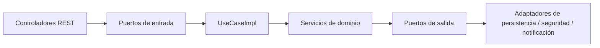

# Puertos de entrada

## Introducción

Los **puertos de entrada** (`application.domain.ports.in`) definen *qué casos de uso ofrece cada rol* sin decir cómo. Hay **un puerto por rol** más uno de acceso público; los controladores REST dependen únicamente de ellos y nunca de los servicios de dominio.

Todo método recibe y devuelve **modelos de dominio** (nunca DTOs). Quien invoca (`User user`) se pasa siempre como primer argumento: es el usuario autenticado que el adaptador de seguridad ya cargó de la base de datos.

| Puerto | Rol | Prefijo REST | Implementación |
|---|---|---|---|
| `PublicAccessPort` | Acceso público | `/api/v1/auth`, `/api/v1/catalog` | `PublicAccessUseCaseImpl` |
| `BuyerPort` | Comprador | `/api/v1/buyer` | `BuyerUseCaseImpl` |
| `SellerPort` | Vendedor | `/api/v1/seller` | `SellerUseCaseImpl` |
| `LogisticOperatorPort` | Operador logístico | `/api/v1/logistic-operator` | `LogisticOperatorUseCaseImpl` |
| `AdminPort` | Administrador | `/api/v1/admin` | `AdminUseCaseImpl` |
| `SupervisorPort` | Supervisor | `/api/v1/supervisor` | `SupervisorUseCaseImpl` |

---

## Acceso público (`PublicAccessPort`)

Operaciones sin sesión previa: login, logout, autorregistro de compradores y catálogo público.

- Prefijo REST: `/api/v1/auth`, `/api/v1/catalog`
- Rol requerido: —
- Métodos: **7**

| Método del puerto | Servicio de dominio |
|---|---|
| `AuthenticationResult login(User user)` | `LoginService` |
| `void logout(User user)` | `LogoutService` |
| `Buyer registerBuyer(Buyer buyer)` | `RegisterBuyerService` |
| `Buyer registerBuyerAccount(Buyer buyer, User account)` | `RegisterBuyerAccountService` |
| `User registerBuyerUser(User user)` | `RegisterBuyerUserService` |
| `List<Product> consultPublishedProducts()` | `ConsultPublishedProductsService` |
| `Product consultPublishedProduct(Product product)` | `ConsultPublishedProductService` |

---

## Comprador (`BuyerPort`)

Perfil, carrito, pedidos, pagos, facturas, envíos propios, devoluciones, reembolsos y operaciones propias. Nunca inventarios ni información de otros compradores.

- Prefijo REST: `/api/v1/buyer`
- Rol requerido: BUYER
- Métodos: **19**

| Método del puerto | Servicio de dominio |
|---|---|
| `Buyer consultMyProfile(User user)` | `ConsultBuyerProfileService` |
| `Buyer addAddress(User user, Address address)` | `AddBuyerAddressService` |
| `Buyer removeAddress(User user, Address address)` | `RemoveBuyerAddressService` |
| `Cart consultMyCart(User user)` | `ConsultCartService` |
| `Cart addItemToCart(User user, CartItem item)` | `AddItemToCartService` |
| `Cart updateCartItem(User user, CartItem item)` | `UpdateCartItemQuantityService` |
| `Cart removeCartItem(User user, CartItem item)` | `RemoveCartItemService` |
| `Cart clearCart(User user)` | `ClearCartService` |
| `Order checkout(User user, Order order)` | `CheckoutService` |
| `Order payOrder(User user, Order order)` | `PayOrderService` |
| `Order cancelOrder(User user, Order order)` | `CancelOrderService` |
| `List<Order> consultMyOrders(User user)` | `ConsultBuyerOrdersService` |
| `Order consultMyOrder(User user, Order order)` | `FindBuyerOrderService` |
| `Invoice consultMyInvoice(User user, Order order)` | `ConsultOrderInvoiceService` |
| `Shipment consultMyShipment(User user, Order order)` | `ConsultOrderShipmentService` |
| `ReturnRequestResult requestReturn(User user, ProductReturn productReturn)` | `RequestReturnService` |
| `List<ProductReturn> consultMyReturns(User user)` | `ConsultBuyerReturnsService` |
| `List<Refund> consultMyRefunds(User user)` | `ConsultBuyerRefundsService` |
| `List<Operation> consultMyOperations(User user)` | `ConsultUserOperationsService` |

---

## Vendedor (`SellerPort`)

Registro y gestión de sus propios productos, ingreso de inventario en sus propias bodegas y consulta de sus pedidos (solo sus líneas).

- Prefijo REST: `/api/v1/seller`
- Rol requerido: SELLER
- Métodos: **13**

| Método del puerto | Servicio de dominio |
|---|---|
| `Product registerProduct(User user, Product product)` | `RegisterProductService` |
| `Product updateProduct(User user, Product changes)` | `UpdateProductService` |
| `Product addProductVariant(User user, Product product, ProductVariant variant)` | `AddProductVariantService` |
| `Product publishProduct(User user, Product product)` | `PublishProductService` |
| `Product suspendProduct(User user, Product product)` | `SuspendProductService` |
| `Product discontinueProduct(User user, Product product)` | `DiscontinueProductService` |
| `List<Product> consultMyProducts(User user)` | `ConsultSellerProductsService` |
| `List<Warehouse> consultMyWarehouses(User user)` | `ConsultSellerWarehousesService` |
| `Inventory registerInventoryInflow(User user, InventoryMovement movement)` | `RegisterInventoryInflowService` |
| `List<Inventory> consultMyInventory(User user)` | `ConsultSellerInventoryService` |
| `List<Order> consultMyOrders(User user)` | `ConsultSellerOrdersService` |
| `Order consultMyOrder(User user, Order order)` | `ConsultSellerOrderService` |
| `List<Operation> consultMyOperations(User user)` | `ConsultUserOperationsService` |

---

## Operador logístico (`LogisticOperatorPort`)

Bodegas, inventario (ingreso, ajuste, daño), pedidos, despachos, entregas y recepción de devoluciones.

- Prefijo REST: `/api/v1/logistic-operator`
- Rol requerido: LOGISTIC_OPERATOR
- Métodos: **16**

| Método del puerto | Servicio de dominio |
|---|---|
| `List<Warehouse> consultWarehouses(User user)` | `ConsultWarehousesService` |
| `List<Inventory> consultWarehouseInventory(User user, Warehouse warehouse)` | `ConsultWarehouseInventoryService` |
| `List<InventoryMovement> consultInventoryMovements(User user, Inventory inventory)` | `ConsultInventoryMovementsService` |
| `Inventory registerInventoryInflow(User user, InventoryMovement movement)` | `RegisterInventoryInflowService` |
| `Inventory adjustInventory(User user, InventoryMovement movement)` | `AdjustInventoryService` |
| `Inventory markInventoryDamaged(User user, InventoryMovement movement)` | `MarkInventoryDamagedService` |
| `Inventory markInventoryAvailable(User user, InventoryMovement movement)` | `MarkInventoryAvailableService` |
| `List<Order> consultOrders(User user)` | `ConsultAllOrdersService` |
| `Order consultOrder(User user, Order order)` | `ConsultOrderService` |
| `List<Shipment> consultShipments(User user, Shipment filter)` | `ConsultShipmentsService` |
| `Shipment dispatchShipment(User user, Shipment shipment)` | `DispatchShipmentService` |
| `Shipment confirmDelivery(User user, Shipment shipment)` | `ConfirmShipmentDeliveryService` |
| `List<ProductReturn> consultReturnsToReceive(User user)` | `ConsultReturnsToReceiveService` |
| `ProductReturn receiveReturn(User user, ProductReturn productReturn)` | `ReceiveReturnService` |
| `ProductReturn rejectReturn(User user, ProductReturn productReturn)` | `RejectReturnService` |
| `List<Operation> consultMyOperations(User user)` | `ConsultUserOperationsService` |

---

## Administrador (`AdminPort`)

Incorporación de vendedores, usuarios internos, bodegas, estados, decisión de reembolsos, auditoría y reportes.

- Prefijo REST: `/api/v1/admin`
- Rol requerido: ADMIN
- Métodos: **16**

| Método del puerto | Servicio de dominio |
|---|---|
| `Seller registerSeller(User admin, Seller seller, Warehouse firstWarehouse)` | `IncorporateSellerService` |
| `User registerSellerUser(User admin, User sellerUser)` | `RegisterSellerUserService` |
| `User registerStaffUser(User admin, User newUser)` | `RegisterStaffUserService` |
| `User changeUserStatus(User admin, User target, UserStatus newStatus)` | `ChangeUserStatusService` |
| `List<User> consultUsers(User admin)` | `ConsultUsersService` |
| `Buyer changeBuyerStatus(User admin, Buyer buyer, BuyerStatus newStatus)` | `ChangeBuyerStatusService` |
| `Warehouse createWarehouse(User admin, Warehouse warehouse)` | `CreateWarehouseService` |
| `Warehouse updateWarehouse(User admin, Warehouse changes)` | `UpdateWarehouseService` |
| `Warehouse changeWarehouseStatus(User admin, Warehouse warehouse, WarehouseStatus newStatus)` | `ChangeWarehouseStatusService` |
| `List<Warehouse> consultWarehouses(User admin)` | `ConsultWarehousesService` |
| `List<Refund> consultPendingRefunds(User admin)` | `ConsultRefundsService` |
| `Refund approveRefund(User admin, Refund refund)` | `ApproveRefundService` |
| `Refund rejectRefund(User admin, Refund refund)` | `RejectRefundService` |
| `List<AuditLog> consultAuditLog(User admin, AuditLog filter)` | `ConsultAuditLogsService` |
| `List<Operation> consultAllOperations(User admin)` | `ConsultAllOperationsService` |
| `AdministrativeSummary consultSummary(User admin)` | `ConsultAdministrativeSummaryService` |

---

## Supervisor (`SupervisorPort`)

Consulta y seguimiento operativo de solo lectura: reportes, usuarios, productos, bodegas, inventario, pedidos, envíos, reembolsos y auditoría.

- Prefijo REST: `/api/v1/supervisor`
- Rol requerido: SUPERVISOR
- Métodos: **11**

| Método del puerto | Servicio de dominio |
|---|---|
| `AdministrativeSummary consultSummary(User supervisor)` | `ConsultAdministrativeSummaryService` |
| `List<User> consultUsers(User supervisor)` | `ConsultUsersService` |
| `List<Product> consultProducts(User supervisor)` | `ConsultAllProductsService` |
| `List<Warehouse> consultWarehouses(User supervisor)` | `ConsultWarehousesService` |
| `List<Inventory> consultWarehouseInventory(User supervisor, Warehouse warehouse)` | `ConsultWarehouseInventoryService` |
| `List<Order> consultOrders(User supervisor)` | `ConsultAllOrdersService` |
| `Order consultOrder(User supervisor, Order order)` | `ConsultOrderService` |
| `List<Shipment> consultShipments(User supervisor, Shipment filter)` | `ConsultShipmentsService` |
| `List<Refund> consultRefunds(User supervisor, Refund filter)` | `ConsultRefundsService` |
| `List<AuditLog> consultAuditLog(User supervisor, AuditLog filter)` | `ConsultAuditLogsService` |
| `List<Operation> consultAllOperations(User supervisor)` | `ConsultAllOperationsService` |

---
