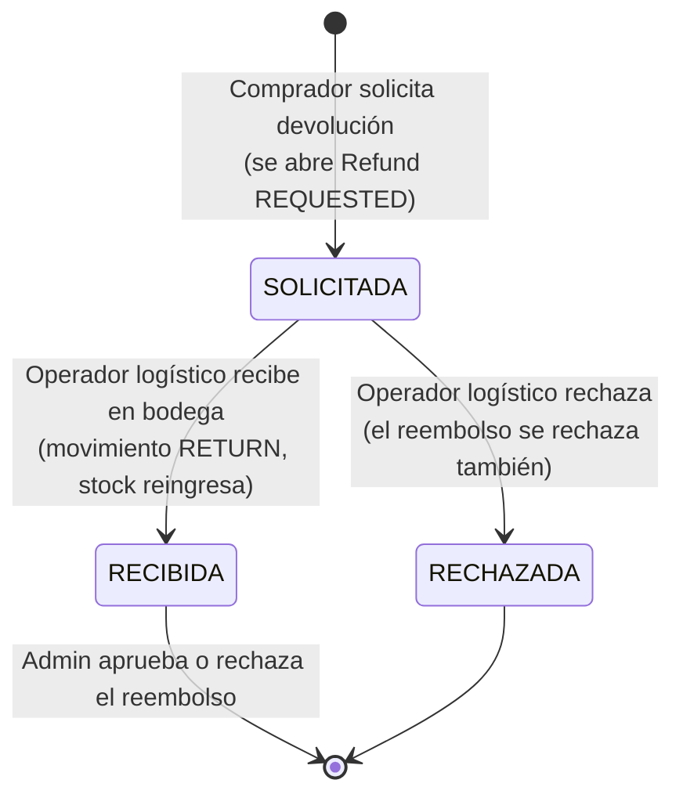
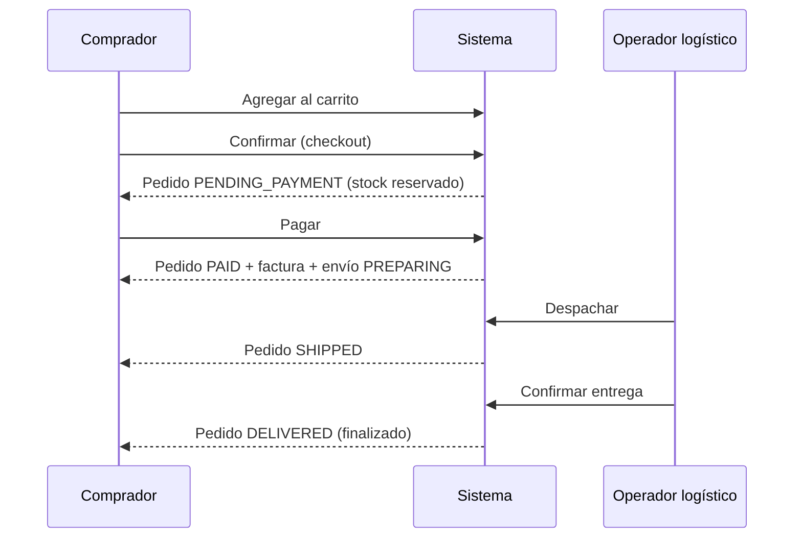

# Enunciado de NexusMarket para el desarrollo

> **Qué es este documento.** `especificacion_funcional_nexusmarket.md` es la especificación funcional entregada. Este enunciado la **interpreta para el desarrollo**, siguiendo la misma estructura del enunciado del proyecto de referencia (roles, información de usuarios, productos, flujos, bitácora, reglas y restricciones de acceso). Donde la especificación guarda silencio se indica **«Decisión de diseño»**; todas esas decisiones se listan en `Supuestos-y-vacios.md`.

## Introducción y objetivo del proyecto

NexusMarket es el *core* transaccional de un marketplace: intermedia entre **compradores** y **vendedores** y administra el ciclo completo —usuarios, catálogo, inventario distribuido en bodegas, carrito, pedidos, facturación, envíos, devoluciones y reembolsos— con trazabilidad total. El sistema se construye con **DDD y arquitectura hexagonal** (puertos y adaptadores), API REST con JWT, PostgreSQL para los datos transaccionales y MongoDB para la bitácora de auditoría.

# Descripción de los roles

El acceso es por roles y **cada usuario tiene exactamente un rol** (RG-02). La visibilidad y las operaciones están limitadas por las responsabilidades de cada rol (RG-03).

## Comprador (`BUYER`)

Persona que adquiere productos publicados. Se **autorregistra** (perfil y luego cuenta de usuario).

- Administra su perfil y sus direcciones de entrega (la principal no se puede eliminar).
- Gestiona su carrito, confirma pedidos, los paga o los cancela mientras estén pendientes de pago.
- Consulta sus pedidos, su factura y su envío, y sus propias operaciones.
- Solicita devoluciones de productos físicos entregados (dentro de la ventana de devolución) y consulta sus reembolsos.
- **Nunca** ve ni administra información de otros compradores ni inventarios.

## Vendedor (`SELLER`)

Tercero que comercializa sus productos. **No se autorregistra:** lo incorpora el Administrador junto con su primera bodega.

- Registra productos con variantes (nacen **SUSPENDIDOS**), los publica, suspende o descontinúa, y edita nombre, descripción y precio.
- Registra ingresos de inventario **solo** en sus propias bodegas y consulta su stock.
- Consulta los pedidos que contienen sus productos, **restringidos a sus propias líneas**.
- **Nunca** gestiona productos, bodegas ni pedidos de otros vendedores.

## Operador Logístico (`LOGISTIC_OPERATOR`)

Responsable de la operación física de bodegas y despachos.

- Consulta bodegas, inventario y movimientos; registra ingresos; ajusta stock; marca inventario como dañado o lo restituye a disponible.
- Consulta pedidos; despacha envíos y confirma entregas.
- Recibe o rechaza las devoluciones.

## Administrador (`ADMIN`)

Responsable de vendedores, bodegas, usuarios internos y reembolsos.

- Incorpora vendedores y su primera bodega; crea las cuentas de usuario de vendedores y de personal interno (operador logístico, supervisor, administrador).
- Crea, actualiza y cambia el estado de bodegas; cambia el estado de usuarios y el estado comercial de compradores.
- Aprueba o rechaza reembolsos.
- Consulta la bitácora y el resumen administrativo.

## Supervisor (`SUPERVISOR`)

Perfil de **solo consulta** y seguimiento operativo: resumen administrativo, usuarios, productos, bodegas, inventario, pedidos, envíos, reembolsos y bitácora. **No puede modificar nada.**

# Información de los usuarios del sistema

Todos los usuarios, sin importar su rol, comparten esta información (la misma que el dominio 1 de la especificación funcional):

| Campo | Descripción | Tipo | Restricciones |
|---|---|---|---|
| `id` | Identificador interno | Entero | Clave primaria, generado |
| `identification` | Documento de identidad | Texto (máx. 30 en el contrato REST) | **Único** en toda la plataforma, obligatorio, sin espacios al inicio/fin |
| `name` | Nombre completo | Texto (máx. 120) | Obligatorio, no vacío |
| `email` | Correo electrónico (medio de acceso) | Texto (máx. 160) | **Único** en toda la plataforma, formato válido, obligatorio |
| `role` | Rol (`SystemRole`) | Catálogo | Obligatorio, **uno por usuario** |
| `status` | Estado de acceso (`UserStatus`) | Catálogo | `ACTIVE`, `INACTIVE`, `BLOCKED` |
| contraseña | Credencial | Texto (8–100) | Al menos una letra y un dígito; se guarda cifrada con BCrypt |
| buyer / seller | Perfil asociado | Referencia | Solo usuarios `BUYER` y `SELLER` |

El correo y la identificación son únicos **entre compradores, vendedores y usuarios** (un correo de comprador no puede coincidir con el de un usuario interno). *Decisión de diseño: se valida con los repositorios de las tres entidades.*

# Productos y servicios manejados por la aplicación

## Producto y variantes

| Campo | Descripción | Restricciones |
|---|---|---|
| `name` | Nombre | Obligatorio (máx. 200) |
| `description` | Descripción | Opcional (máx. 2000) |
| `type` | `PHYSICAL` o `DIGITAL` | Obligatorio |
| `price` | `Money` (monto + moneda) | Mayor que cero |
| `status` | `PUBLISHED`, `SUSPENDED`, `DISCONTINUED` | Nace `SUSPENDED`; `DISCONTINUED` es terminal |
| variantes | Color, talla, modelo… | Al menos una; **SKU único** en todo el catálogo |

Los productos **físicos** requieren inventario y despacho; los **digitales** no usan inventario y se entregan al pagar.

## Inventario

Existencias de **una variante en una bodega**. Mantiene `onHand` (físico), `reserved` y estado de calidad (`AVAILABLE` / `DAMAGED`). Movimientos: **Ingreso, Reserva, Salida por venta, Ajuste y Devolución** (más la liberación de reserva al cancelar). Invariantes: **nunca negativo**, lo reservado nunca supera lo físico y lo dañado no se reserva.

## Bodega

Lugar físico con nombre, tipo (`MARKETPLACE` o `SELLER`), dirección y estado (`ACTIVE`/`INACTIVE`). Una bodega de vendedor pertenece a exactamente un vendedor.

## Carrito y pedido

El carrito es la selección provisional de un comprador. Al confirmarlo se crea el **pedido** en `PENDING_PAYMENT`, se reserva el stock de los ítems físicos y se vacía el carrito.

Ciclo: `PENDING_PAYMENT → PAID → SHIPPED → DELIVERED`, o `PENDING_PAYMENT → CANCELLED`. Un pedido **finalizado** (`DELIVERED` o `CANCELLED`) no se modifica bajo ninguna circunstancia.

## Factura

Se emite al pagar el pedido: número consecutivo (`INV-00000001`), subtotal, impuesto y total. *Decisión de diseño: impuesto de ventas del 19 % configurable (`BUSINESS_TAX_RATE`).* Es una instantánea inmutable.

## Envío

Solo para pedidos con ítems físicos. Ciclo: `PREPARING → SHIPPED → DELIVERED`, con número de guía. Los pedidos solo digitales se entregan inmediatamente tras el pago, sin envío.

## Devolución y reembolso

El comprador solicita la devolución de un producto físico entregado; con ella se abre un reembolso por el valor devuelto. *Decisión de diseño: ventana de devolución de 30 días desde la entrega, configurable (`BUSINESS_RETURN_WINDOW_DAYS`); la suma de cantidades de devoluciones activas no puede superar lo comprado; los productos digitales no se devuelven.*

# Flujos de aprobación de operaciones

## Flujo de devolución y reembolso

- **Un reembolso solo se aprueba después de recibir la mercancía** devuelta.
- La decisión (aprobar/rechazar) la toma **únicamente el Administrador** y registra quién decidió, cuándo y una nota.
- Un reembolso ya decidido no puede decidirse de nuevo.

## Flujo de compra

# Bitácora de operaciones (almacenamiento NoSQL)

Toda operación significativa se registra como `Operation` (PostgreSQL) y como **registro de auditoría inmutable** en MongoDB (`audit_db.audit_logs`). La bitácora sirve para seguimiento histórico y auditoría; **no se usa para calcular existencias ni totales**.

| Campo | Descripción | Restricciones |
|---|---|---|
| `auditId` | Identificador único del registro | Único, obligatorio |
| `operationType` | Tipo de operación (`OperationType`: `ORDER_PAYMENT`, `STOCK_RESERVATION`…) | Obligatorio |
| `operationDate` | Fecha y hora de la operación | Obligatorio |
| `performedBy` | Usuario que ejecutó la acción | Obligatorio |
| `userRole` | Rol del usuario al momento de la operación | Obligatorio |
| `affectedResource` | Recurso afectado (tipo + id) | Obligatorio |
| `details` | Documento con datos variables según la operación | Obligatorio (puede estar vacío) |
| `severity` | Severidad | `INFORMATION` por defecto |

Ejemplos de `details`: en un pago, el método de pago y el total; en una reserva, la variante y la cantidad; en una decisión de reembolso, el monto y la nota. **Nunca** contienen contraseñas.

# Reglas de negocio y condiciones de validación

## Reglas generales

| Código | Regla |
|---|---|
| RG-01 | Toda operación (salvo las públicas: login, registro de comprador y catálogo) la ejecuta un usuario **autenticado y ACTIVO**. |
| RG-02 | Cada usuario tiene **un único rol**. |
| RG-03 | Ningún participante administra información fuera de su rol. |

## Validaciones críticas

- **Inventario:** no se reserva inventario inexistente o `DAMAGED`; no hay existencias negativas.
- **Pedidos:** un pedido finalizado no se modifica; un pedido pagado no se cancela; no se paga dos veces.
- **Usuarios:** identificación y correo únicos en la plataforma.
- **Vendedores:** solo los registra el Administrador.
- **Catálogo:** SKU único; solo un producto `PUBLISHED` entra al carrito y al catálogo público.
- **Compradores:** un comprador `RESTRICTED` no puede comprar; la dirección de envío debe pertenecer al comprador.

# Restricciones de acceso por rol (seguridad de la información)

Todos los usuarios tienen correo y contraseña; para cualquier operación deben estar autenticados y tener permiso. Si intentan acceder a un flujo sin permiso se les impide (**403**); sin token válido, **401**.

| Rol | Puede consultar | Puede modificar | No puede |
|---|---|---|---|
| Comprador | Su perfil, carrito, pedidos, factura, envío, devoluciones, reembolsos y operaciones | Sus direcciones, carrito, pedidos (pagar/cancelar), solicitar devoluciones | Ver datos de otros compradores ni inventarios |
| Vendedor | Sus productos, bodegas, inventario y las líneas propias de pedidos | Sus productos; ingresos en sus bodegas | Tocar productos, bodegas o pedidos ajenos; registrarse solo |
| Operador logístico | Bodegas, inventario, movimientos, pedidos, envíos, devoluciones por recibir | Inventario (ingreso, ajuste, daño), envíos, devoluciones | Registrar productos, decidir reembolsos |
| Administrador | Usuarios, bodegas, reembolsos, bitácora, resumen | Vendedores, usuarios internos, bodegas, estados, reembolsos | Operar la logística ni el catálogo de vendedores |
| Supervisor | Todo lo anterior en modo lectura | — | Modificar cualquier cosa |

# Conclusiones para el desarrollo

El desarrollo exige comprender el negocio y segregar la información por rol. A partir de este enunciado y de la especificación funcional se deduce:

1. El **modelo relacional** (usuarios, compradores, vendedores, bodegas, productos y variantes, inventario y movimientos, carritos, pedidos y líneas, facturas, envíos, devoluciones, reembolsos, operaciones) → `Adapters/Persistence-adapters.md`.
2. El **esquema documental** de la bitácora → mismo documento.
3. El **dominio** (modelos, value objects, servicios con responsabilidad única) → `domain/`.
4. Los **puertos de entrada por rol**, los casos de uso, la **API REST**, la seguridad JWT/CORS y el manejo de errores → `Adapters/`.
